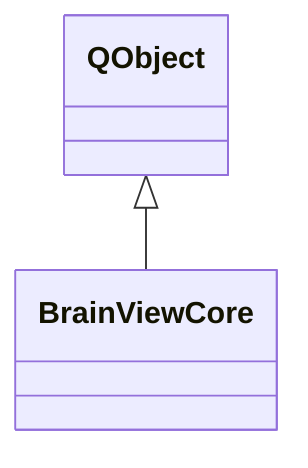

# BrainViewCore

**Namespace:** `mne::viz::qt` &nbsp;·&nbsp; **Library:** Visualization: Qt Backend &nbsp;·&nbsp; **Source:** [`viz/backends/qt/3d/view/brainviewcore.h`](https://github.com/mne-tools/mne-cpp/blob/staging/src/libs/mne/viz/backends/qt/3d/view/brainviewcore.h)

`#include <mne/viz/backends/qt/brainviewcore.h>`

```cpp
class mne::viz::qt::BrainViewCore
```

[`BrainViewCore`](/docs/api/viz-qt/brain-view-core) is the Widgets-free part of the 3-D brain view.

It owns the scene state and the renderer and is driven by a [`BrainViewHost`](/docs/api/viz-qt/brain-view-host) that forwards QtGui input events and frames.

Embed it through [`BrainView`](/docs/api/viz-qt/brain-view) in a widget hierarchy, or through [`BrainWindow`](/docs/api/viz-qt/brain-window), a QWindow that widget applications embed with a window container (createWindowContainer()).

Widgets-free 3-D brain scene: model wiring, camera, multi-view, picking, overlay and QRhi frame recording.

### Inheritance



---

## Public Methods

### BrainViewCore(host, parent)

Constructor.

Restores the persisted view layout (QSettings group "[BrainView](/docs/api/viz-qt/brain-view)").

**Parameters:**

- **host** : *[BrainViewHost](/docs/api/viz-qt/brain-view-host) **
  [`Surface`](/docs/api/viz/surface) showing the view (not owned), or nullptr until `setHost()` is called.

- **parent** : *QObject **
  Parent object.

---

### ~BrainViewCore()

Destructor.

Persists the view layout.

---

### setHost(host)

Set the surface showing this view.

**Parameters:**

- **host** : *[BrainViewHost](/docs/api/viz-qt/brain-view-host) **
  Host (not owned), or nullptr to detach.

---

### host()

**Returns:**

- *[BrainViewHost](/docs/api/viz-qt/brain-view-host) ** — The surface showing this view, or nullptr.

---

### initialize(rhi, colorTexture)

(Re)create the renderer and its render targets on a colour texture, e.g.

from QRhiWidget::initialize(). Earlier GPU resources are dropped.

**Parameters:**

- **rhi** : *QRhi **
  QRhi the texture belongs to.

- **colorTexture** : *QRhiTexture **
  Texture rendered into.

---

### render(rhi, colorTexture, sampleCount, cb)

Record one frame (3-D scene and 2-D overlay) into a colour texture.

The renderer is created on first use and keeps a clearing and a preserving render target on the texture.

**Parameters:**

- **rhi** : *QRhi **
  QRhi recording the frame.

- **colorTexture** : *QRhiTexture **
  Texture rendered into.

- **sampleCount** : *int*
  Sample count of the pipelines.

- **cb** : *QRhiCommandBuffer **
  [`Command`](/docs/api/viz/command) buffer of the current frame.

---

### render(rhi, renderTarget, cb)

Record one frame (3-D scene and 2-D overlay) into a render target owned by the caller, such as the current target of a QRhiSwapChain.

The renderer is created on first use.

**Parameters:**

- **rhi** : *QRhi **
  QRhi recording the frame.

- **renderTarget** : *QRhiRenderTarget **
  Target to clear and draw into; it must have a depth-stencil buffer.

- **cb** : *QRhiCommandBuffer **
  [`Command`](/docs/api/viz/command) buffer of the current frame.

---

### releaseResources()

Free all GPU resources, e.g.

from QRhiWidget::releaseResources() or before the QRhi is destroyed.

---

### hasRenderer()

**Returns:**

- *bool* — Whether a renderer (and thus GPU resources) exists.

---

### handleMousePress(event)

Handle a mouse press: pane selection, splitter drag start or pane preset menu.

**Parameters:**

- **event** : *QMouseEvent **
  Event in logical surface coordinates.

---

### handleMouseMove(event)

Handle a mouse move: camera rotation / panning, splitter drags and hover picking.

**Parameters:**

- **event** : *QMouseEvent **
  Event in logical surface coordinates.

---

### handleMouseRelease(event)

Handle a mouse release: ends drags and emits the click signals.

**Parameters:**

- **event** : *QMouseEvent **
  Event in logical surface coordinates.

---

### handleMouseDoubleClick(event)

Handle a double click on a surface.

**Parameters:**

- **event** : *QMouseEvent **
  Event in logical surface coordinates.

**Returns:**

- *bool* — Whether the event was consumed; otherwise the host should pass it on.

---

### handleWheel(event)

Handle a wheel event: zooms the single view or the pane under the pointer.

**Parameters:**

- **event** : *QWheelEvent **
  Event in logical surface coordinates.

---

### handleKeyPress(event)

Handle a key press: S saves a snapshot, R resets the camera rotation.

**Parameters:**

- **event** : *QKeyEvent **
  `Key` event.

---

### handleResize()

Relayout the overlay and the pane separators after the host surface was resized.

---

### cameraRotation()

**Returns:**

- *QQuaternion* — Camera rotation of the single view.

---

### zoomForTarget(target)

Zoom of the single view or of one multi-view pane.

**Parameters:**

- **target** : *int*
  -1=Single, 0..3 = multi-view pane.

**Returns:**

- *float* — Zoom steps (one wheel notch is 1).

---

### overlayText(item, viewport)

Text of an overlay label.

**Parameters:**

- **item** : *OverlayItem*
  Overlay item.

- **viewport** : *int*
  Pane index for the per-pane items, ignored otherwise.

**Returns:**

- *QString* — The text, empty for separators and invalid panes.

---

### overlayGeometry(item, viewport)

Geometry of an overlay item in logical surface coordinates.

**Parameters:**

- **item** : *OverlayItem*
  Overlay item.

- **viewport** : *int*
  Pane index for the per-pane items, ignored otherwise.

**Returns:**

- *QRect* — The rectangle, empty for invalid panes.

---

### isOverlayItemVisible(item, viewport)

Whether an overlay item is drawn.

**Parameters:**

- **item** : *OverlayItem*
  Overlay item.

- **viewport** : *int*
  Pane index for the per-pane items, ignored otherwise.

**Returns:**

- *bool* — True if the item is shown.

---

### overlayImage(pixelSize, devicePixelRatio)

Paint the 2-D overlay (labels and pane separators) that is blended over the 3-D scene.

**Parameters:**

- **pixelSize** : *const QSize &*
  Size of the image in physical pixels.

- **devicePixelRatio** : *qreal*
  Ratio of physical to logical pixels.

**Returns:**

- *QImage* — Premultiplied ARGB image, transparent where nothing is drawn.

---

### setModel(model)

Set the data model and show the objects it already holds.

Objects of a previous model are removed from the view (the previous model is not modified).

**Parameters:**

- **model** : *[BrainTreeModel](/docs/api/viz-qt/brain-tree-model) **
  Pointer to [`BrainTreeModel`](/docs/api/viz-qt/brain-tree-model), or nullptr to detach.

---

### setInitialCameraRotation(rotation)

Set the initial camera rotation for this view.

Each view can start from a different orientation (e.g., top, front, left).

**Parameters:**

- **rotation** : *const QQuaternion &*
  Initial camera rotation quaternion.

---

## Example

No example of its own: Widgets-free scene core that needs a host surface and a QRhi; applications use it through BrainView or BrainWindow.

## Authors of this file

- Christoph Dinh &lt;christoph.dinh@mne-cpp.org&gt;
