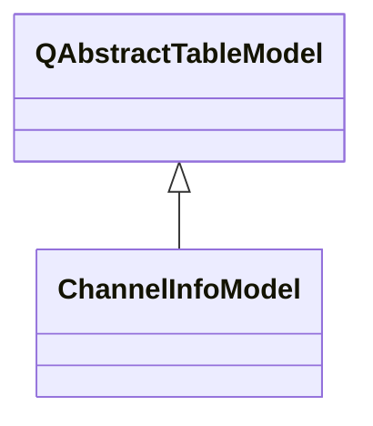

# ChannelInfoModel

**Namespace:** `mne::viz::qt` &nbsp;·&nbsp; **Library:** Visualization: Qt Backend &nbsp;·&nbsp; **Source:** [`viz/backends/qt/viewers/helpers/channelinfomodel.h`](https://github.com/mne-tools/mne-cpp/blob/staging/src/libs/mne/viz/backends/qt/viewers/helpers/channelinfomodel.h)

`#include <mne/viz/backends/qt/channelinfomodel.h>`

```cpp
class mne::viz::qt::ChannelInfoModel
```

QAbstractTableModel exposing per-channel FIFF metadata (name, type, unit, position, bad flag, mapping).

Each row maps a FIFF channel to its presentation attributes and listens for live edits from the channel-selection / mapping dialogs so the underlying [`FiffInfo`](/docs/api/fiff/fiff-info) is updated in place.

### Inheritance



---

## Public Methods

### ChannelInfoModel(pFiffInfo, parent)

---

### ChannelInfoModel(parent)

---

### rowCount(parent)

Reimplemented virtual functions.

**Parameters:**

- **parent** : *const QModelIndex &*
  Parent index (unused; the model is a flat list).

**Returns:**

- *int* — Number of channels in the attached measurement info.

---

### columnCount(parent)

---

### headerData(section, orientation, role)

---

### data(index, role)

---

### setData(index, value, role)

---

### flags(index)

---

### insertRows(position, span, parent)

---

### removeRows(position, span, parent)

---

### setFiffInfo(pFiffInfo)

Updates the fiff info.

**Parameters:**

- **pFiffInfo** : *std::shared_ptr&lt; [FiffInfo](/docs/api/fiff/fiff-info) &gt; &*
  fiff info variabel.

---

### assignedOperatorsChanged(assignedOperators)

Updates the fiff info.

**Parameters:**

- **assignedOperators** : *const QMultiMap&lt; int, std::shared_ptr&lt; [MNEOperator](/docs/api/viz-qt/mne-operator) &gt; &gt; &*
  the filter operators which are currently active.

---

### layoutChanged(layoutMap)

Updates the layout map.

**Parameters:**

- **layoutMap** : *const std::map&lt; std::string, QPointF &gt; &*
  the layout map with the 2D positions.

---

### getMappedChannelsList()

Updates the layout map.

**Returns:**

- *const std::vector&lt; std::string &gt; &* — the current mapped channel list.

---

### getIndexFromOrigChName(chName)

Returns the model index for the given input channel fro mthe original channel list.

**Parameters:**

- **chName** : *const std::string &*
  the channel name for which the model index is needed.

**Returns:**

- *int* — the index number. if channel was not found in the data this functions returns -1.

---

### getIndexFromMappedChName(chName)

Returns the model index for the given input channel fro mthe mapped channel list.

**Parameters:**

- **chName** : *const std::string &*
  the channel name for which the model index is needed.

**Returns:**

- *int* — the index number. if channel was not found in the data this functions returns -1.

---

### getBadChannelList()

Returns bad channel list.

**Returns:**

- *StringList* — the bad channel list.

---

### clearModel()

clearModel clears all model's members

---

## Authors of this file

- Lorenz Esch &lt;lorenz.esch@tu-ilmenau.de&gt;
- Christoph Dinh &lt;christoph.dinh@mne-cpp.org&gt;
- Matti Hamalainen &lt;msh@nmr.mgh.harvard.edu&gt;
- Jens Haueisen &lt;jens.haueisen@tu-ilmenau.de&gt;
- Gabriel Motta &lt;gabrielbenmotta@gmail.com&gt;
- Juan GPC &lt;jgarciaprieto@mgh.harvard.edu&gt;
