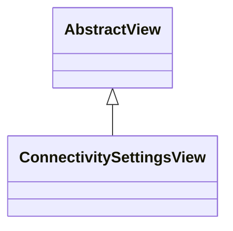

# ConnectivitySettingsView

**Namespace:** `mne::viz::qt` &nbsp;·&nbsp; **Library:** Visualization: Qt Backend &nbsp;·&nbsp; **Source:** [`viz/backends/qt/viewers/connectivitysettingsview.h`](https://github.com/mne-tools/mne-cpp/blob/staging/src/libs/mne/viz/backends/qt/viewers/connectivitysettingsview.h)

`#include <mne/viz/backends/qt/connectivitysettingsview.h>`

```cpp
class mne::viz::qt::ConnectivitySettingsView
```

Settings panel for the on-line connectivity estimator (metric, window, trials).

Combo boxes pick the connectivity metric (coherence, PLV, PLI, wPLI, dwPLI, ImCoh, Granger / PDC / DTF) and the windowing function; spinboxes set the number of trials. Edits propagate via Qt signals to the `rtprocessing` connectivity job.

### Inheritance



---

## Public Methods

### ConnectivitySettingsView(sSettingsPath, parent, f)

Constructs a [`ConnectivitySettingsView`](/docs/api/viz-qt/connectivity-settings-view) which is a child of parent.

**Parameters:**

- **sSettingsPath** : *const QString &*
  Settings path under which the widget persists its state (empty = no persistence).

- **parent** : *QWidget **
  parent of widget.

- **f** : *Qt::WindowFlags*
  Qt window flags passed to the QWidget constructor.

---

### ~ConnectivitySettingsView()

Destroys the [`ConnectivitySettingsView`](/docs/api/viz-qt/connectivity-settings-view).

---

### setTriggerTypes(lTriggerTypes)

Destroys the [`ConnectivitySettingsView`](/docs/api/viz-qt/connectivity-settings-view).

**Parameters:**

- **lTriggerTypes** : *const QStringList &*
  The new trigger types.

---

### setNumberTrials(iNumberTrials)

Sets the new number of trials.

**Parameters:**

- **iNumberTrials** : *int*
  The new number of trials.

---

### setFrequencyBand(dFreqLow, dFreqHigh)

Sets the frequency band.

**Parameters:**

- **dFreqLow** : *double*
  The lower frequency.

- **dFreqHigh** : *double*
  The upper frequency.

---

### getConnectivityMetric()

Get the current connectivity metric.

**Returns:**

- *QString* — The current connectivity metric.

---

### getWindowType()

Get the current window type.

**Returns:**

- *QString* — The current window type.

---

### getNumberTrials()

Get the current number of trials.

**Returns:**

- *int* — The current number of trials.

---

### getTriggerType()

Get the current trigger type.

**Returns:**

- *QString* — The current trigger type.

---

### getLowerFreq()

Get the current lower frequency range.

**Returns:**

- *double* — The current lower frequency range.

---

### getUpperFreq()

Get the current upper frequency range.

**Returns:**

- *double* — The current upper frequency range.

---

### saveSettings()

Saves all important settings of this view via QSettings.

---

### loadSettings()

Loads and inits all important settings of this view via QSettings.

---

### clearView()

Clears the view.

---

## Authors of this file

- Lorenz Esch &lt;lorenz.esch@tu-ilmenau.de&gt;
- Gabriel Motta &lt;gabrielbenmotta@gmail.com&gt;
- Juan GPC &lt;jgarciaprieto@mgh.harvard.edu&gt;
- Christoph Dinh &lt;christoph.dinh@mne-cpp.org&gt;
