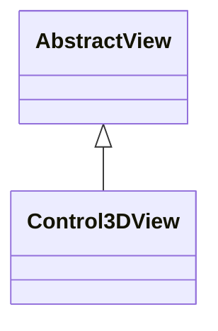

# Control3DView

**Namespace:** `mne::viz::qt` &nbsp;·&nbsp; **Library:** Visualization: Qt Backend &nbsp;·&nbsp; **Source:** [`viz/backends/qt/viewers/control3dview.h`](https://github.com/mne-tools/mne-cpp/blob/staging/src/libs/mne/viz/backends/qt/viewers/control3dview.h)

`#include <mne/viz/backends/qt/control3dview.h>`

```cpp
class mne::viz::qt::Control3DView
```

Tree-view control panel for the 3-D scene (visibility, colour, alpha, threshold per item).

Hosts a `QTreeView` bound to the `Data3DTreeModel` and a custom `QStyledItemDelegate` that paints colour swatches and slider editors inline so edits propagate directly to the renderer.

### Inheritance



---

## Public Methods

### Control3DView(sSettingsPath, parent, slFlags, type)

Default constructor.

**Parameters:**

- **sSettingsPath** : *const QString &*
  Settings path under which the widget persists its state (empty = no persistence).

- **parent** : *QWidget **
  The parent of the QObject.

- **slFlags** : *const std::vector&lt; std::string &gt; &*
  The flags indicating which tools to display. Scaling is displayed as default. Possible flags are: "Data", "View", "Light".

- **type** : *Qt::WindowType*
  Qt window type passed to the QWidget constructor.

---

### ~Control3DView()

Destroys the [`Control3DView`](/docs/api/viz-qt/control3-d-view).

---

### setFlags(slFlags)

Set the flags specifying which part of the GUI should be shown.

**Parameters:**

- **slFlags** : *const std::vector&lt; std::string &gt; &*
  flags.

---

### setDelegate(pItemDelegate)

Set the delegate for the tree view.

**Parameters:**

- **pItemDelegate** : *QStyledItemDelegate **
  The delegate.

---

### setModel(pDataTreeModel)

Init the control widget based on the 3D view and data model.

**Parameters:**

- **pDataTreeModel** : *QStandardItemModel **
  The 3D data tree model.

---

### onTreeViewHeaderHide()

Slot called when tree view header visibilty changed.

---

### onTreeViewRemoveItem(index)

Slot called when an item should be removed.

**Parameters:**

- **index** : *const QModelIndex &*
  Model index of the tree view row to remove; ignored if invalid.

---

### onTreeViewDescriptionHide()

Slot called when tree view description visibilty changed.

---

### saveSettings()

Saves all important settings of this view via QSettings.

---

### loadSettings()

Loads and inits all important settings of this view via QSettings.

---

## Authors of this file

- Lorenz Esch &lt;lorenz.esch@tu-ilmenau.de&gt;
- Matti Hamalainen &lt;msh@nmr.mgh.harvard.edu&gt;
- Gabriel Motta &lt;gabrielbenmotta@gmail.com&gt;
- Juan GPC &lt;jgarciaprieto@mgh.harvard.edu&gt;
- Christoph Dinh &lt;christoph.dinh@mne-cpp.org&gt;
