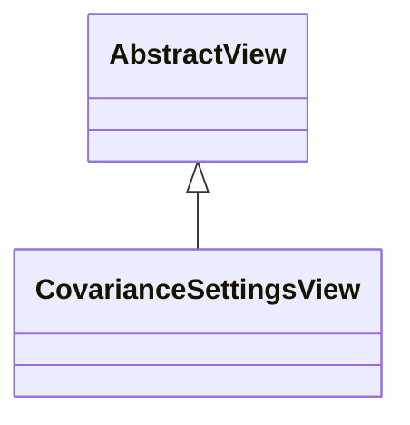

# CovarianceSettingsView

**Namespace:** `mne::viz::qt` &nbsp;·&nbsp; **Library:** Visualization: Qt Backend &nbsp;·&nbsp; **Source:** [`viz/backends/qt/viewers/covariancesettingsview.h`](https://github.com/mne-tools/mne-cpp/blob/staging/src/libs/mne/viz/backends/qt/viewers/covariancesettingsview.h)

`#include <mne/viz/backends/qt/covariancesettingsview.h>`

```cpp
class mne::viz::qt::CovarianceSettingsView
```

Settings panel exposing the noise-covariance estimation window length.

Holds a single `QSpinBox` forwarded as `changeMinNumberSamples` to the `rtprocessing` covariance estimator.

### Inheritance



---

## Public Methods

### CovarianceSettingsView(sSettingsPath, parent)

---

### ~CovarianceSettingsView()

Destroys the [`CovarianceSettingsView`](/docs/api/viz-qt/covariance-settings-view).

---

### setCurrentSamples(iSamples)

Set current samples to gather until a new covariance is calculated.

**Parameters:**

- **iSamples** : *int*
  new number samples.

---

### setMinSamples(iSamples)

Set minimum number of samples to gather until a new covariance is calculated.

**Parameters:**

- **iSamples** : *int*
  new minimum number of samples.

---

### saveSettings()

Saves all important settings of this view via QSettings.

---

### loadSettings()

Loads and inits all important settings of this view via QSettings.

---

### clearView()

Clears the view.

---

## Authors of this file

- Lorenz Esch &lt;lorenz.esch@tu-ilmenau.de&gt;
- Gabriel Motta &lt;gabrielbenmotta@gmail.com&gt;
- Juan GPC &lt;jgarciaprieto@mgh.harvard.edu&gt;
- Christoph Dinh &lt;christoph.dinh@mne-cpp.org&gt;
