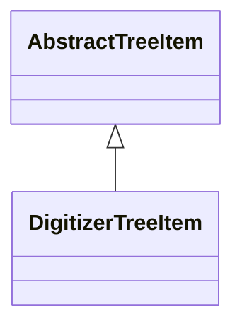

# DigitizerTreeItem

**Namespace:** `mne::viz::qt` &nbsp;·&nbsp; **Library:** Visualization: Qt Backend &nbsp;·&nbsp; **Source:** [`viz/backends/qt/3d/model/items/digitizertreeitem.h`](https://github.com/mne-tools/mne-cpp/blob/staging/src/libs/mne/viz/backends/qt/3d/model/items/digitizertreeitem.h)

`#include <mne/viz/backends/qt/digitizertreeitem.h>`

```cpp
class mne::viz::qt::DigitizerTreeItem
```

[`DigitizerTreeItem`](/docs/api/viz-qt/digitizer-tree-item) represents a group of digitizer points of the same category (Cardinal, HPI, EEG, Extra) in the tree model.

Each item stores batched 3D positions for efficient rendering as a single mesh with replicated sphere geometry.

This matches the mne_viz_qt [`DigitizerTreeItem`](/docs/api/viz-qt/digitizer-tree-item) pattern using per-category grouping with color-coded sphere rendering.

Digitizer point group tree item.

### Inheritance



---

## Public Methods

### DigitizerTreeItem(text, kind, positions, names, color, scale, type)

Constructs a [`DigitizerTreeItem`](/docs/api/viz-qt/digitizer-tree-item) for a single category of digitizer points.

**Parameters:**

- **text** : *const QString &*
  Display text for the item (e.g. "Cardinal", "HPI", "EEG", "Extra").

- **kind** : *PointKind*
  The digitizer point category.

- **positions** : *const std::vector&lt; QVector3D &gt; &*
  3D positions of all points in this category (in meters).

- **names** : *const std::vector&lt; std::string &gt; &*
  Display names for individual points (e.g. "Nasion", "LPA").

- **color** : *const QColor &*
  [`Color`](/docs/api/viz/color) for rendering this category.

- **scale** : *float*
  Radius of each rendered sphere.

- **type** : *int*
  Item type identifier.

---

### ~DigitizerTreeItem()

---

### positions()

Returns all point positions in this category.

**Returns:**

- *const std::vector&lt; QVector3D &gt; &* — Vector of 3D position vectors.

---

### pointNames()

Returns the display names for individual points.

**Returns:**

- *const std::vector&lt; std::string &gt; &* — List of point names.

---

### scale()

Returns the rendering scale (sphere radius).

**Returns:**

- *float* — Scale value in meters.

---

### pointKind()

Returns the digitizer point category.

**Returns:**

- *PointKind* — [`Point`](/docs/api/viz/point) kind enum value.

---

## Authors of this file

- Christoph Dinh &lt;christoph.dinh@mne-cpp.org&gt;
