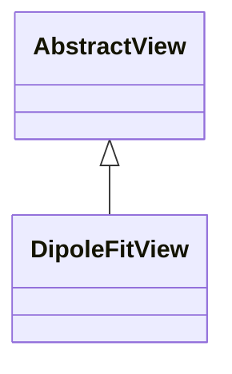

# DipoleFitView

**Namespace:** `mne::viz::qt` &nbsp;·&nbsp; **Library:** Visualization: Qt Backend &nbsp;·&nbsp; **Source:** [`viz/backends/qt/viewers/dipolefitview.h`](https://github.com/mne-tools/mne-cpp/blob/staging/src/libs/mne/viz/backends/qt/viewers/dipolefitview.h)

`#include <mne/viz/backends/qt/dipolefitview.h>`

```cpp
class mne::viz::qt::DipoleFitView
```

Single-equivalent-current-dipole-fit input / result panel.

Collects measurement / BEM / covariance / trans inputs and a time window, launches the underlying `mne::DipoleFit` job, then renders the fitted position, orientation, magnitude and goodness-of-fit in a result table.

### Inheritance



---

## Public Methods

### DipoleFitView(parent, f)

---

### ~DipoleFitView()

---

### saveSettings()

Saves all important settings of this view via QSettings.

---

### loadSettings()

Loads and inits all important settings of this view via QSettings.

---

### addBem(sFileName)

Updates GUI to show selected BEM file.

**Parameters:**

- **sFileName** : *const QString &*
  Path of the BEM file.

---

### addMri(sFileName)

Updates GUI to show selected MRI file.

**Parameters:**

- **sFileName** : *const QString &*
  Path of the MRI file.

---

### addNoise(sFileName)

Updates GUI to show selecte Noise file.

**Parameters:**

- **sFileName** : *const QString &*
  Path of the noise covariance file.

---

### addMeas(sFileName)

Updates GUI to show selected measurement file.

**Parameters:**

- **sFileName** : *const QString &*
  Path of the measurement file.

---

### removeModel(sModelName, iType)

Removes model from view.

**Parameters:**

- **sModelName** : *const QString &*
  name of model to be removed.

- **iType** : *int*
  type of model (1-measurement, 2-BEM, 3-MRI, 4-Cov).

---

### requestParams()

Sends updated signals for parameters (excluding selected models).

---

### clearView()

Clears the view.

---

## Authors of this file

- Gabriel Motta &lt;gabrielbenmotta@gmail.com&gt;
- Juan GPC &lt;jgarciaprieto@mgh.harvard.edu&gt;
- Christoph Dinh &lt;christoph.dinh@mne-cpp.org&gt;
