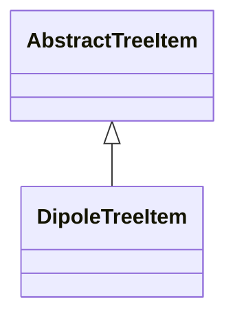

# DipoleTreeItem

**Namespace:** `mne::viz::qt` &nbsp;·&nbsp; **Library:** Visualization: Qt Backend &nbsp;·&nbsp; **Source:** [`viz/backends/qt/3d/model/items/dipoletreeitem.h`](https://github.com/mne-tools/mne-cpp/blob/staging/src/libs/mne/viz/backends/qt/3d/model/items/dipoletreeitem.h)

`#include <mne/viz/backends/qt/dipoletreeitem.h>`

```cpp
class mne::viz::qt::DipoleTreeItem
```

Tree item representing a set of fitted dipoles in the 3-D scene hierarchy.

### Inheritance



---

## Public Methods

### DipoleTreeItem(text, set, type)

---

### ~DipoleTreeItem()

---

### ecdSet()

---

## Authors of this file

- Christoph Dinh &lt;christoph.dinh@mne-cpp.org&gt;
