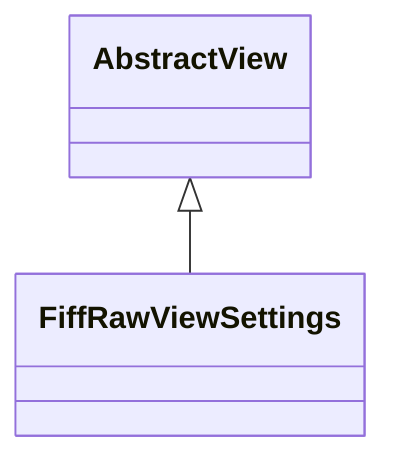

# FiffRawViewSettings

**Namespace:** `mne::viz::qt` &nbsp;·&nbsp; **Library:** Visualization: Qt Backend &nbsp;·&nbsp; **Source:** [`viz/backends/qt/viewers/fiffrawviewsettings.h`](https://github.com/mne-tools/mne-cpp/blob/staging/src/libs/mne/viz/backends/qt/viewers/fiffrawviewsettings.h)

`#include <mne/viz/backends/qt/fiffrawviewsettings.h>`

```cpp
class mne::viz::qt::FiffRawViewSettings
```

Display-style settings panel for the FIFF raw browser (zoom, colours, distance, scope).

Bundles the visible time window, signal / background / trigger colours and the distance-to-axis spinbox with an embedded [`ApplyToView`](/docs/api/viz-qt/apply-to-view) so the user controls whether changes affect selected / visible / all channels.

### Inheritance



---

## Public Methods

### FiffRawViewSettings(sSettingsPath, parent, f)

Constructs a [`FiffRawViewSettings`](/docs/api/viz-qt/fiff-raw-view-settings) which is a child of parent.

**Parameters:**

- **sSettingsPath** : *const QString &*
  Settings path under which the widget persists its state (empty = no persistence).

- **parent** : *QWidget **
  parent of widget.

- **f** : *Qt::WindowFlags*
  Qt window flags passed to the QWidget constructor.

---

### ~FiffRawViewSettings()

Destroys the [`FiffRawViewSettings`](/docs/api/viz-qt/fiff-raw-view-settings).

---

### setWidgetList(lVisibleWidgets)

Init the view.

**Parameters:**

- **lVisibleWidgets** : *const std::vector&lt; std::string &gt; &*
  The widgets to be visible: numberChannels, windowSize, distanceSpacers,. backgroundcolor, signalColor, screenshot

---

### setWindowSize(windowSize)

Sets the values of the windowSize spin box.

**Parameters:**

- **windowSize** : *int*
  new window size value.

---

### setZoom(zoomFactor)

Sets the values of the zoomFactor spin box.

**Parameters:**

- **zoomFactor** : *double*
  new zoomFactor value.

---

### getDistanceTimeSpacer()

Get current distance time spacer.

**Returns:**

- *int* — the current distance time spacer.

---

### setDistanceTimeSpacer(value)

Set current distance time spacer combo box.

**Parameters:**

- **value** : *int*
  the new value of the combo box.

---

### setBackgroundColor(backgroundColor)

Set current background color.

**Parameters:**

- **backgroundColor** : *const QColor &*
  The new background color.

---

### setSignalColor(signalColor)

Set current signal color.

**Parameters:**

- **signalColor** : *const QColor &*
  The new signal color.

---

### getSignalColor()

Returns the current signal color.

**Returns:**

- *const QColor &* — The current signal color.

---

### getBackgroundColor()

Returns the current background color.

**Returns:**

- *const QColor &* — The current background color.

---

### getZoom()

Returns the current zoom.

**Returns:**

- *double* — The current zoom.

---

### getWindowSize()

Returns the current window size.

**Returns:**

- *int* — The current window size.

---

### saveSettings()

Saves all important settings of this view via QSettings.

---

### loadSettings()

Loads and inits all important settings of this view via QSettings.

---

### clearView()

Clears the view.

---

## Authors of this file

- Lorenz Esch &lt;lorenz.esch@tu-ilmenau.de&gt;
- Matti Hamalainen &lt;msh@nmr.mgh.harvard.edu&gt;
- Gabriel Motta &lt;gabrielbenmotta@gmail.com&gt;
- Juan GPC &lt;jgarciaprieto@mgh.harvard.edu&gt;
- Christoph Dinh &lt;christoph.dinh@mne-cpp.org&gt;
