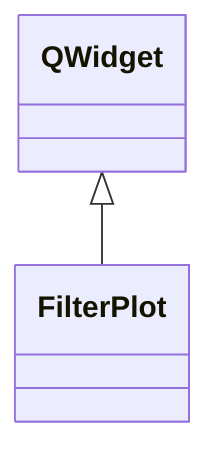

# FilterPlot

**Namespace:** `mne::viz::qt` &nbsp;·&nbsp; **Library:** Visualization: Qt Backend &nbsp;·&nbsp; **Source:** [`viz/backends/qt/plots/filterplot.h`](https://github.com/mne-tools/mne-cpp/blob/staging/src/libs/mne/viz/backends/qt/plots/filterplot.h)

`#include <mne/viz/backends/qt/filterplot.h>`

```cpp
class mne::viz::qt::FilterPlot
```

Magnitude response of a FIR or IIR filter in dB, with its cut-off frequencies marked.

```cpp title="src/examples/ex_disp_plots/main.cpp"
// Band pass 1-40 Hz at 250 Hz, 256 taps; frequencies are normed to the Nyquist frequency of 125 Hz
const FilterKernel bandPass("BPF_1_40", FilterKernel::filter_type_index("BPF"), 256, 20.5 / 125.0, 39.0 / 125.0,
                            5.0 / 125.0, 250.0, FilterKernel::design_method_index("Cosine"));
FilterPlot filterPlot;
filterPlot.setFilter(bandPass);
```

### Inheritance



---

## Public Methods

### FilterPlot(parent)

Constructs an empty plot.

**Parameters:**

- **parent** : *QWidget **
  Parent widget.

---

### setFilter(filter)

Shows the response of `filter:` its FFT magnitude from 0 Hz to half its sampling frequency, titled with its name, with its high-pass and low-pass frequencies marked where they lie inside that range.

**Parameters:**

- **filter** : *const [FilterKernel](/docs/api/dsp/filter-kernel) &*
  The filter; one without coefficients leaves the plot unchanged.

---

### plot()

**Returns:**

- *const [FilterResponsePlot](/docs/api/viz/filter-response-plot) &* — The plot model.

---

### figure(size)

The plot as a figure, e.g.

to export it with `viz::write_svg()` or render it with `paintScene()`.

**Parameters:**

- **size** : *const QSize &*
  Size of the figure in pixels.

**Returns:**

- *[DisplayList](/docs/api/viz/display-list)* — The figure on a white background, laid out with this widget's font.

---

## Example

- Start here: [ex_disp_plots](../../examples/viz_qt/ex_disp_plots.mdx) — Disp plots: colour maps, bar and spline histograms, line plots, image and time-frequency maps.
- Full source: [`src/examples/ex_disp_plots/main.cpp`](https://github.com/mne-tools/mne-cpp/tree/staging/src/examples/ex_disp_plots/main.cpp)
- Build target: `ex_disp_plots` (runs under CTest)

## Authors of this file

- Christoph Dinh &lt;christoph.dinh@mne-cpp.org&gt;
