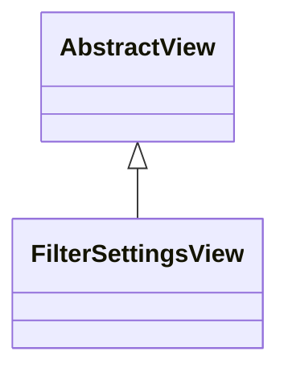

# FilterSettingsView

**Namespace:** `mne::viz::qt` &nbsp;·&nbsp; **Library:** Visualization: Qt Backend &nbsp;·&nbsp; **Source:** [`viz/backends/qt/viewers/filtersettingsview.h`](https://github.com/mne-tools/mne-cpp/blob/staging/src/libs/mne/viz/backends/qt/viewers/filtersettingsview.h)

`#include <mne/viz/backends/qt/filtersettingsview.h>`

```cpp
class mne::viz::qt::FilterSettingsView
```

Compact filter on / off + bandwidth panel that opens the full [`FilterDesignView`](/docs/api/viz-qt/filter-design-view) on demand.

Houses an activation `QCheckBox`, from / to frequency labels and an `Edit` button; the two widgets stay in sync via `filterChannelTypeChanged` and `filterChanged` signals.

### Inheritance



---

## Public Methods

### FilterSettingsView(sSettingsPath, parent, f)

Constructs a [`FilterSettingsView`](/docs/api/viz-qt/filter-settings-view) which is a child of parent.

**Parameters:**

- **sSettingsPath** : *const QString &*
  Settings path under which the widget persists its state (empty = no persistence).

- **parent** : *QWidget **
  parent of widget.

- **f** : *Qt::WindowFlags*
  Qt window flags passed to the QWidget constructor.

---

### ~FilterSettingsView()

Destroys the [`FilterSettingsView`](/docs/api/viz-qt/filter-settings-view).

---

### getFilterView()

Returns the filter design view used to design filters.

**Returns:**

- *std::shared_ptr&lt; [FilterDesignView](/docs/api/viz-qt/filter-design-view) &gt;* — Shared pointer to the owned [`FilterDesignView`](/docs/api/viz-qt/filter-design-view).

---

### getFilterActive()

Returns true if the filters a set as active.

**Returns:**

- *bool* — True if the activate-filter check box is checked.

---

### setSamplingRate(dSFreq)

Sets the sampling frequency and setups this view accrodingly.

**Parameters:**

- **dSFreq** : *double*
  the new sampling frequency.

---

### saveSettings()

Saves all important settings of this view via QSettings.

---

### loadSettings()

Loads and inits all important settings of this view via QSettings.

---

### clearView()

Clears the view.

---

## Authors of this file

- Lorenz Esch &lt;lorenz.esch@tu-ilmenau.de&gt;
- Gabriel Motta &lt;gabrielbenmotta@gmail.com&gt;
- Juan GPC &lt;jgarciaprieto@mgh.harvard.edu&gt;
- Christoph Dinh &lt;christoph.dinh@mne-cpp.org&gt;
