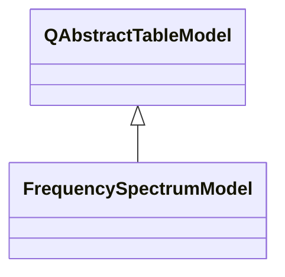

# FrequencySpectrumModel

**Namespace:** `mne::viz::qt` &nbsp;·&nbsp; **Library:** Visualization: Qt Backend &nbsp;·&nbsp; **Source:** [`viz/backends/qt/viewers/helpers/frequencyspectrummodel.h`](https://github.com/mne-tools/mne-cpp/blob/staging/src/libs/mne/viz/backends/qt/viewers/helpers/frequencyspectrummodel.h)

`#include <mne/viz/backends/qt/frequencyspectrummodel.h>`

```cpp
class mne::viz::qt::FrequencySpectrumModel
```

QAbstractTableModel storing per-channel FFT magnitudes for [`SpectrumView`](/docs/api/viz-qt/spectrum-view).

Maintains an `Eigen::MatrixXd` of channels × frequency bins; ``addData()`` appends or averages new FFT frames and emits `dataChanged` so the view repaints the affected rows.

### Inheritance



---

## Public Methods

### FrequencySpectrumModel(parent)

Constructs an real-time multi sample array table model for the given parent.

**Parameters:**

- **parent** : *QObject **
  parent of the table model.

---

### rowCount(parent)

Returns the number of rows under the given parent.

When the parent is valid it means that rowCount is returning the number of children of parent.

**Parameters:**

- **parent** : *const QModelIndex &*
  not used.

**Returns:**

- *int* — number of rows.

---

### columnCount(parent)

Returns the number of columns for the children of the given parent.

**Parameters:**

- **parent** : *const QModelIndex &*
  not used.

**Returns:**

- *int* — number of columns.

---

### data(index, role)

Returns the data stored under the given role for the item referred to by the index.

**Parameters:**

- **index** : *const QModelIndex &*
  determines item location.

- **role** : *int*
  role to return.

**Returns:**

- *QVariant* — accessed data.

---

### headerData(section, orientation, role)

Returns the data for the given role and section in the header with the specified orientation.

**Parameters:**

- **section** : *int*
  For horizontal headers, the section number corresponds to the column number. Similarly, for vertical headers, the section number corresponds to the row number.

- **orientation** : *Qt::Orientation*
  Qt::Horizontal or Qt::Vertical.

- **role** : *int*
  role to show.

**Returns:**

- *QVariant* — accessed eader data.

---

### setInfo(info)

Sets corresponding fiff info.

**Parameters:**

- **info** : *std::shared_ptr&lt; [FiffInfo](/docs/api/fiff/fiff-info) &gt; &*
  The corresponding fiff information object.

---

### setScaleType(ScaleType)

Sets Scale type.

**Parameters:**

- **ScaleType** : *qint8*
  The corresponding scale type.

---

### addData(data)

Adds the frequency estimation.

**Parameters:**

- **data** : *const Eigen::MatrixXd &*
  the frequency estimation.

---

### getInfo()

Returns the fiff info.

**Returns:**

- *std::shared_ptr&lt; [FiffInfo](/docs/api/fiff/fiff-info) &gt;* — the fiff info.

---

### getFreqScale()

Returns the frequency scale of the x axis.

**Returns:**

- *Eigen::RowVectorXd* — the frequency scale of the x axis.

---

### getFreqScaleBound()

Returns the frequency scale scaled to boundaries of the x axis.

**Returns:**

- *Eigen::RowVectorXd* — the frequency scale of the x axis.

---

### getNumStems()

Returns the number of stems.

**Returns:**

- *qint32* — the number of stems.

---

### getIdxSelMap()

Returns a map which conatins the channel idx and its corresponding selection status.

**Returns:**

- *const std::map&lt; int, int &gt; &* — the channel idx to selection status.

---

### selectRows(selection)

Selects the given list of channel indeces and unselect all other channels.

**Parameters:**

- **selection** : *const std::vector&lt; int &gt; &*
  channel index list to select.

---

### resetSelection()

Resets the current selection (selects all channels).

---

### toggleFreeze(index)

Toggle freeze for all channels when a channel is double clicked.

**Parameters:**

- **index** : *const QModelIndex &*
  of the channel which has been double clicked.

---

### isFreezed()

Returns current freezing status.

**Returns:**

- *bool* — the current freezing status.

---

### setBoundaries(fLowerFrqBound, fUpperFrqBound)

Set plotting boundaries.

**Parameters:**

- **fLowerFrqBound** : *float*
  Lower frequency boudnary.

- **fUpperFrqBound** : *float*
  Upper frequency boudnary.

---

### getLowerFrqBound()

Returns the lower frequency boundary.

**Returns:**

- *qint32* — the lower frequency boundary.

---

### getUpperFrqBound()

Returns the upper frequency boundary.

**Returns:**

- *qint32* — the upper frequency boundary.

---

## Authors of this file

- Christoph Dinh &lt;christoph.dinh@mne-cpp.org&gt;
- Matti Hamalainen &lt;msh@nmr.mgh.harvard.edu&gt;
- Lorenz Esch &lt;lorenz.esch@tu-ilmenau.de&gt;
- Juan GPC &lt;jgarciaprieto@mgh.harvard.edu&gt;
- Gabriel Motta &lt;gabrielbenmotta@gmail.com&gt;
- Limin Sun &lt;limin.sun@childrens.harvard.edu&gt;
