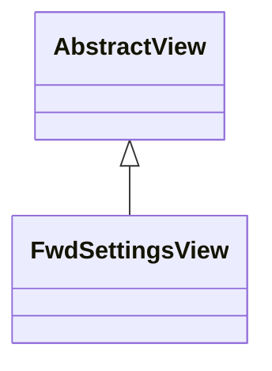

# FwdSettingsView

**Namespace:** `mne::viz::qt` &nbsp;·&nbsp; **Library:** Visualization: Qt Backend &nbsp;·&nbsp; **Source:** [`viz/backends/qt/viewers/fwdsettingsview.h`](https://github.com/mne-tools/mne-cpp/blob/staging/src/libs/mne/viz/backends/qt/viewers/fwdsettingsview.h)

`#include <mne/viz/backends/qt/fwdsettingsview.h>`

```cpp
class mne::viz::qt::FwdSettingsView
```

Forward-solution computation control panel (BEM / source-space / EEG sphere model selectors).

Exposes the parameters required by the `mne_fwd` recomputation job and provides a `Recompute` trigger plus live status labels showing the currently loaded BEM and dipole / sensor counts.

### Inheritance



---

## Public Methods

### FwdSettingsView(sSettingsPath, parent, f)

Constructs a [`FwdSettingsView`](/docs/api/viz-qt/fwd-settings-view) object.

**Parameters:**

- **sSettingsPath** : *const QString &*
  QSettings key prefix used to persist view settings (default empty).

- **parent** : *QWidget **
  Parent widget (default 0).

- **f** : *Qt::WindowFlags*
  Window flags passed to the widget (default Qt::Widget).

---

### ~FwdSettingsView()

---

### getRecomputationStatusChanged()

Get status of recomputation check box.

**Returns:**

- *bool* — If recomputation status is checked.

---

### setRecomputationStatus(iStatus)

Updates the clustering status (0 Initializing, 1 Computing, 2 Recomputing, 3 Clustering, 4 Not Computed, 5 Finished).

**Parameters:**

- **iStatus** : *int*
  status of recomputation.

---

### getClusteringStatusChanged()

Get status of clustering check box.

**Returns:**

- *bool* — Wheter clustering is checked or not.

---

### getClusterNumber()

Get status of cluster size spin box.

**Returns:**

- *int* — Desired number of sources in clustered source space.

---

### showAtlasDirDialog()

Shows atlas selection dialog.

---

### setSolutionInformation(iSourceOri, iCoordFrame, iNSource, iNChan, iNSpaces)

Updates forward solution information.

**Parameters:**

- **iSourceOri** : *mne::fiff_int_t*
  Source orientation: fixed or free.

- **iCoordFrame** : *mne::fiff_int_t*
  Coil coordinate system definition.

- **iNSource** : *int*
  Number of source dipoles.

- **iNChan** : *int*
  Number of channels.

- **iNSpaces** : *int*
  Number of source spaces.

---

### setClusteredInformation(iNSource)

Updates clustered forward solution information.

**Parameters:**

- **iNSource** : *int*
  Number of clustered source dipoles.

---

### onClusteringStatusChanged(bChecked)

Updates clustered forward solution information.

**Parameters:**

- **bChecked** : *bool*
  Whether the clustering check box is checked..

---

### saveSettings()

Saves all important settings of this view via QSettings.

---

### loadSettings()

Loads and inits all important settings of this view via QSettings.

---

### clearView()

Clears the view.

---

## Authors of this file

- Ruben Doerfel &lt;doerfelruben@aol.com&gt;
- Lorenz Esch &lt;lorenz.esch@tu-ilmenau.de&gt;
- Gabriel Motta &lt;gabrielbenmotta@gmail.com&gt;
- Juan GPC &lt;jgarciaprieto@mgh.harvard.edu&gt;
- Christoph Dinh &lt;christoph.dinh@mne-cpp.org&gt;
