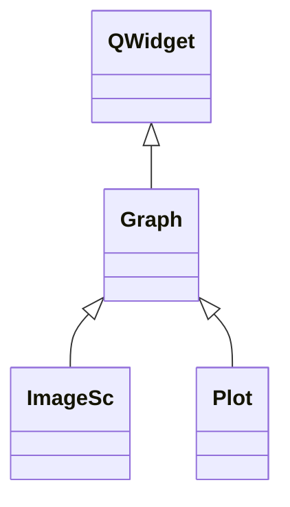

# Graph

**Namespace:** `mne::viz::qt` &nbsp;·&nbsp; **Library:** Visualization: Qt Backend &nbsp;·&nbsp; **Source:** [`viz/backends/qt/plots/graph.h`](https://github.com/mne-tools/mne-cpp/blob/staging/src/libs/mne/viz/backends/qt/plots/graph.h)

`#include <mne/viz/backends/qt/graph.h>`

```cpp
class mne::viz::qt::Graph
```

Common base widget providing title, axis labels and resize handling for mne_disp's QPainter plots.

Subclasses such as [`Plot`](/docs/api/viz-qt/plot) and [`ImageSc`](/docs/api/viz-qt/image-sc) paint inside the content rectangle that [`Graph`](/docs/api/viz-qt/graph) leaves free after stamping the title bar at the top and the x / y axis labels on the bottom and left margins.

```cpp title="src/examples/ex_disp_plots/main.cpp"
VectorXd samples = VectorXd::LinSpaced(50, -1.0, 1.0);
Plot plot(samples); // Plot is a Graph with title and axis labels
plot.setTitle("ramp");
plot.setXLabel("sample");
plot.setYLabel("value");
```

### Inheritance



---

## Public Methods

### Graph(parent)

The constructor.

**Parameters:**

- **parent** : *QWidget **
  The parent widget.

---

### init()

Init this class.

---

### setTitle(p_sTitle)

Sets the scaled image view title.

**Parameters:**

- **p_sTitle** : *const QString &*
  The title.

---

### setXLabel(p_sXLabel)

Sets the label of the y axes.

**Parameters:**

- **p_sXLabel** : *const QString &*
  The x axes label.

---

### setYLabel(p_sYLabel)

Sets the label of the y axes.

**Parameters:**

- **p_sYLabel** : *const QString &*
  The y axes label.

---

## Example

- Start here: [ex_disp_plots](../../examples/viz_qt/ex_disp_plots.mdx) — Disp plots: colour maps, bar and spline histograms, line plots, image and time-frequency maps.
- Full source: [`src/examples/ex_disp_plots/main.cpp`](https://github.com/mne-tools/mne-cpp/tree/staging/src/examples/ex_disp_plots/main.cpp)
- Build target: `ex_disp_plots` (runs under CTest)

## Authors of this file

- Christoph Dinh &lt;christoph.dinh@mne-cpp.org&gt;
- Matti Hamalainen &lt;msh@nmr.mgh.harvard.edu&gt;
- Lorenz Esch &lt;lorenz.esch@tu-ilmenau.de&gt;
- Gabriel Motta &lt;gabrielbenmotta@gmail.com&gt;
- Juan GPC &lt;jgarciaprieto@mgh.harvard.edu&gt;
