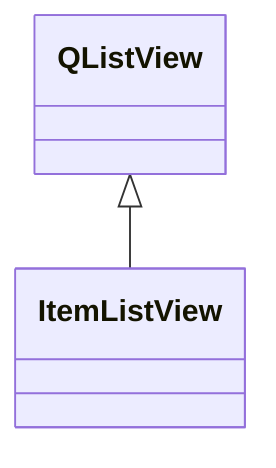

# ItemListView

**Namespace:** `mne::viz::qt` &nbsp;·&nbsp; **Library:** Visualization: Qt Backend &nbsp;·&nbsp; **Source:** [`viz/backends/qt/kit/itemlistview.h`](https://github.com/mne-tools/mne-cpp/blob/staging/src/libs/mne/viz/backends/qt/kit/itemlistview.h)

`#include <mne/viz/backends/qt/itemlistview.h>`

```cpp
class mne::viz::qt::ItemListView
```

The Qt view of a [`ItemList`](/docs/api/viz/item-list): its items, its selection kept in sync both ways, and Delete removing the selected items of removable lists.

### Inheritance



---

## Public Methods

### ItemListView(list, parent)

Shows a list.

**Parameters:**

- **list** : *std::shared_ptr&lt; [ItemList](/docs/api/viz/item-list) &gt;*
  The list, shared with its owner.

- **parent** : *QWidget **
  Parent widget.

---

### ~ItemListView()

---

### list()

**Returns:**

- *[ItemList](/docs/api/viz/item-list) &* — The list.

---

## Example

No example of its own: Qt view of any viz::ItemList, created by PanelWidget for the lists of a panel; exercised by test_viz_qt_viewers2.

## Authors of this file

- Christoph Dinh &lt;christoph.dinh@mne-cpp.org&gt;
