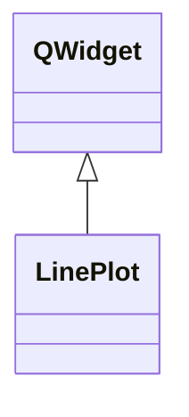

# LinePlot

**Namespace:** `mne::viz::qt` &nbsp;·&nbsp; **Library:** Visualization: Qt Backend &nbsp;·&nbsp; **Source:** [`viz/backends/qt/plots/lineplot.h`](https://github.com/mne-tools/mne-cpp/blob/staging/src/libs/mne/viz/backends/qt/plots/lineplot.h)

`#include <mne/viz/backends/qt/lineplot.h>`

```cpp
class mne::viz::qt::LinePlot
```

Simple x / y line-series QWidget rendered with QPainter (no Qt Charts dependency).

Supports multiple series, a settable title and x / y labels and auto-ranging axes. Series are stored as `std::vector<double>` pairs and re-drawn during `paintEvent`.

```cpp title="src/examples/ex_disp_plots/main.cpp"
std::vector<double> x;
std::vector<double> y;
for (int i = 0; i <= 100; ++i) {
    x.push_back(i / 100.0);
    y.push_back(std::sin(2.0 * std::numbers::pi * x.back()));
}
LinePlot line(x, y, "sin(2 pi t)");
line.setXLabel("t [s]");
line.setYLabel("amplitude");
```

### Inheritance



---

## Public Methods

### LinePlot(parent)

Constructs a line series plot.

**Parameters:**

- **parent** : *QWidget **
  If parent is nullptr, the new widget becomes a window.

---

### LinePlot(y, title, parent)

Constructs a line series plot.

**Parameters:**

- **y** : *const std::vector&lt; double &gt; &*
  The double data vector.

- **title** : *const QString &*
  [`Plot`](/docs/api/viz-qt/plot) title.

- **parent** : *QWidget **
  If parent is nullptr, the new widget becomes a window.

---

### LinePlot(x, y, title, parent)

Constructs a line series plot.

**Parameters:**

- **x** : *const std::vector&lt; double &gt; &*
  X-Axis data to plot.

- **y** : *const std::vector&lt; double &gt; &*
  Y-Axis data to plot.

- **title** : *const QString &*
  [`Plot`](/docs/api/viz-qt/plot) title.

- **parent** : *QWidget **
  If parent is nullptr, the new widget becomes a window.

---

### ~LinePlot()

Destructs the line series plot.

---

### setTitle(p_sTitle)

Sets the plot title.

**Parameters:**

- **p_sTitle** : *const QString &*
  The title.

---

### setXLabel(p_sXLabel)

Sets the label of the x axis.

**Parameters:**

- **p_sXLabel** : *const QString &*
  The x axis label.

---

### setYLabel(p_sYLabel)

Sets the label of the y axis.

**Parameters:**

- **p_sYLabel** : *const QString &*
  The y axis label.

---

### updateData(y)

Updates the plot using a given double vector without given X data.

**Parameters:**

- **y** : *const std::vector&lt; double &gt; &*
  The double data vector.

---

### updateData(x, y)

Updates the plot using the given vectors.

**Parameters:**

- **x** : *const std::vector&lt; double &gt; &*
  X-Axis data to plot.

- **y** : *const std::vector&lt; double &gt; &*
  Y-Axis data to plot.

---

### addSeries(x, y, label, color, style)

Adds a series to the plot; the axes grow to include it and a legend lists the labelled series.

**Parameters:**

- **x** : *const std::vector&lt; double &gt; &*
  X-Axis data to plot.

- **y** : *const std::vector&lt; double &gt; &*
  Y-Axis data to plot.

- **label** : *const QString &*
  Legend entry; series without a label are not listed.

- **color** : *const QColor &*
  Line colour; an invalid colour takes the first palette colour no other series uses.

- **style** : *Qt::PenStyle*
  Line style, e.g. Qt::DashLine for a series that may coincide with another.

---

### seriesCount()

Returns the number of series in the plot.

**Returns:**

- *int* — The number of series.

---

## Example

- Start here: [ex_disp_plots](../../examples/viz_qt/ex_disp_plots.mdx) — Disp plots: colour maps, bar and spline histograms, line plots, image and time-frequency maps.
- Full source: [`src/examples/ex_disp_plots/main.cpp`](https://github.com/mne-tools/mne-cpp/tree/staging/src/examples/ex_disp_plots/main.cpp)
- Build target: `ex_disp_plots` (runs under CTest)

## Authors of this file

- Lorenz Esch &lt;lorenz.esch@tu-ilmenau.de&gt;
- Juan GPC &lt;jgarciaprieto@mgh.harvard.edu&gt;
- Andreas Griesshammer &lt;ag@fieldlineinc.com&gt;
- Gabriel Motta &lt;gabrielbenmotta@gmail.com&gt;
- Christoph Dinh &lt;christoph.dinh@mne-cpp.org&gt;
