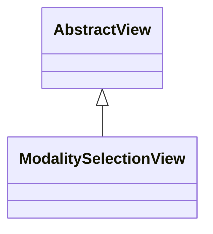

# ModalitySelectionView

**Namespace:** `mne::viz::qt` &nbsp;·&nbsp; **Library:** Visualization: Qt Backend &nbsp;·&nbsp; **Source:** [`viz/backends/qt/viewers/modalityselectionview.h`](https://github.com/mne-tools/mne-cpp/blob/staging/src/libs/mne/viz/backends/qt/viewers/modalityselectionview.h)

`#include <mne/viz/backends/qt/modalityselectionview.h>`

```cpp
class mne::viz::qt::ModalitySelectionView
```

Per-modality visibility toggle panel (one `QCheckBox` per channel modality).

Builds itself from the active [`FiffInfo`](/docs/api/fiff/fiff-info) modalities and emits `modalitiesChanged` so [`ButterflyView`](/docs/api/viz-qt/butterfly-view) and [`AverageLayoutView`](/docs/api/viz-qt/average-layout-view) can hide entire modalities at once.

### Inheritance



---

## Public Methods

### ModalitySelectionView(lChannelList, sSettingsPath, parent, f)

Constructs a [`ModalitySelectionView`](/docs/api/viz-qt/modality-selection-view) which is a child of parent.

**Parameters:**

- **lChannelList** : *const std::vector&lt; [FiffChInfo](/docs/api/fiff/fiff-ch-info) &gt; &*
  Channels whose modalities are offered for selection.

- **sSettingsPath** : *const QString &*
  Settings path under which the widget persists its state (empty = no persistence).

- **parent** : *QWidget **
  parent of widget.

- **f** : *Qt::WindowFlags*
  Qt window flags passed to the QWidget constructor.

---

### ~ModalitySelectionView()

Destroys the [`ModalitySelectionView`](/docs/api/viz-qt/modality-selection-view).

---

### setModalityMap(modalityMap)

Set the modality checkboxes.

**Parameters:**

- **modalityMap** : *const std::map&lt; std::string, bool &gt; &*
  The modality map.

---

### getModalityMap()

Get the activation of the already created modality check boxes.

**Returns:**

- *std::map&lt; std::string, bool &gt;* — The current modality map.

---

### saveSettings()

Saves all important settings of this view via QSettings.

---

### loadSettings()

Loads and inits all important settings of this view via QSettings.

---

### clearView()

Clears the view.

---

## Authors of this file

- Christoph Dinh &lt;christoph.dinh@mne-cpp.org&gt;
- Matti Hamalainen &lt;msh@nmr.mgh.harvard.edu&gt;
- Lorenz Esch &lt;lorenz.esch@tu-ilmenau.de&gt;
- Gabriel Motta &lt;gabrielbenmotta@gmail.com&gt;
- Juan GPC &lt;jgarciaprieto@mgh.harvard.edu&gt;
