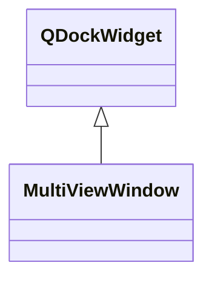

# MultiViewWindow

**Namespace:** `mne::viz::qt` &nbsp;·&nbsp; **Library:** Visualization: Qt Backend &nbsp;·&nbsp; **Source:** [`viz/backends/qt/viewers/multiviewwindow.h`](https://github.com/mne-tools/mne-cpp/blob/staging/src/libs/mne/viz/backends/qt/viewers/multiviewwindow.h)

`#include <mne/viz/backends/qt/multiviewwindow.h>`

```cpp
class mne::viz::qt::MultiViewWindow
```

QDockWidget wrapper used as the building block of [`MultiView`](/docs/api/viz-qt/multi-view) layouts.

Stores the wrapped widget plus a stable name / floating flag so [`MultiView`](/docs/api/viz-qt/multi-view) can re-arrange, retab and persist the dock layout consistently.

### Inheritance



---

## Public Methods

### MultiViewWindow(parent, flags)

Constructs an [`MultiViewWindow`](/docs/api/viz-qt/multi-view-window).

**Parameters:**

- **parent** : *QWidget **
  Parent widget (default nullptr).

- **flags** : *Qt::WindowFlags*
  Window flags passed to the dock widget (default none).

---

### ~MultiViewWindow()

Destructs an [`MultiViewWindow`](/docs/api/viz-qt/multi-view-window).

---

## Authors of this file

- Lorenz Esch &lt;lorenz.esch@tu-ilmenau.de&gt;
- Gabriel Motta &lt;gabrielbenmotta@gmail.com&gt;
- Christoph Dinh &lt;christoph.dinh@mne-cpp.org&gt;
