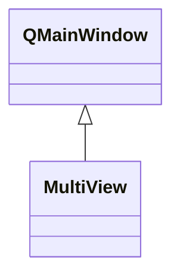

# MultiView

**Namespace:** `mne::viz::qt` &nbsp;·&nbsp; **Library:** Visualization: Qt Backend &nbsp;·&nbsp; **Source:** [`viz/backends/qt/viewers/multiview.h`](https://github.com/mne-tools/mne-cpp/blob/staging/src/libs/mne/viz/backends/qt/viewers/multiview.h)

`#include <mne/viz/backends/qt/multiview.h>`

```cpp
class mne::viz::qt::MultiView
```

QMainWindow container hosting an arbitrary number of [`MultiViewWindow`](/docs/api/viz-qt/multi-view-window) dock widgets.

Inherits `QMainWindow` purely for the dock infrastructure; named views are added with `addWidgetTop` / `addWidgetBottom` and geometry is persisted via `QSettings`.

### Inheritance



---

## Public Methods

### MultiView(sSettingsPath, parent, flags)

Constructs an [`MultiView`](/docs/api/viz-qt/multi-view).

**Parameters:**

- **sSettingsPath** : *const QString &*
  QSettings key prefix used to persist view settings (default empty).

- **parent** : *QWidget **
  Parent widget (default nullptr).

- **flags** : *Qt::WindowFlags*
  Window flags passed to the main window (default Qt::Widget).

---

### ~MultiView()

Destructs an [`MultiView`](/docs/api/viz-qt/multi-view).

---

### addWidgetTop(pWidget, sName)

Adds a QWidget to the top docking area.

**Parameters:**

- **pWidget** : *QWidget **
  The widget to be added.

- **sName** : *const QString &*
  The window title shown in the QSplitter.

**Returns:**

- *[MultiViewWindow](/docs/api/viz-qt/multi-view-window) ** — Returns a pointer to the added widget in form of a [`MultiViewWindow`](/docs/api/viz-qt/multi-view-window).

---

### addWidgetBottom(pWidget, sName)

Adds a QWidget to the bottom docking area.

Please note that all bottom dock widgets are tabbified by default.

**Parameters:**

- **pWidget** : *QWidget **
  The widget to be added.

- **sName** : *const QString &*
  The window title shown in the QSplitter.

**Returns:**

- *[MultiViewWindow](/docs/api/viz-qt/multi-view-window) ** — Returns a pointer to the added widget in form of a [`MultiViewWindow`](/docs/api/viz-qt/multi-view-window).

---

### saveSettings()

Saves geometry and state of GUI dock widgets that have given a name with setObjectName().

---

### loadSettings()

Restores geometry and state as saved by `saveSettings()`.

---

## Authors of this file

- Lorenz Esch &lt;lorenz.esch@tu-ilmenau.de&gt;
- Gabriel Motta &lt;gabrielbenmotta@gmail.com&gt;
- Juan GPC &lt;jgarciaprieto@mgh.harvard.edu&gt;
- Christoph Dinh &lt;christoph.dinh@mne-cpp.org&gt;
