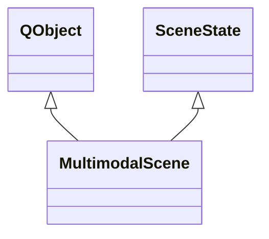

# MultimodalScene

**Namespace:** `mne::viz::qt` &nbsp;·&nbsp; **Library:** Visualization: Qt Backend &nbsp;·&nbsp; **Source:** [`viz/backends/qt/3d/scene/multimodalscene.h`](https://github.com/mne-tools/mne-cpp/blob/staging/src/libs/mne/viz/backends/qt/3d/scene/multimodalscene.h)

`#include <mne/viz/backends/qt/multimodalscene.h>`

```cpp
class mne::viz::qt::MultimodalScene
```

Qt face of [`SceneState`](/docs/api/viz/scene-state) as a QObject: the same API, with its changes as signals.

```cpp title="src/examples/ex_disp3d_scene/main.cpp"
MultimodalScene scene;
scene.registerBoundsFn(SceneLayerKind::Electrode, [](const SceneLayer& layer, Vector3f& bbMin, Vector3f& bbMax) {
    const auto* object = static_cast<const ElectrodeObject*>(layer.payload.get());
    const Eigen::MatrixX3f positions = object->implantation().positions();
    bbMin = positions.colwise().minCoeff().transpose();
    bbMax = positions.colwise().maxCoeff().transpose();
    return true;
});
SceneLayer layer;
layer.id = "seeg_LH";
layer.kind = SceneLayerKind::Electrode;
auto payload = std::make_shared<ElectrodeObject>();
payload->setImplantation(electrodes.implantation());
layer.payload = payload;
scene.addLayer(layer);
scene.setOverlayThresholds(2.0f, 4.0f, 8.0f);
Vector3f bbMin;
Vector3f bbMax;
scene.worldBounds(bbMin, bbMax); // union over visible layers with a bounds function
```

### Inheritance



---

## Public Methods

### MultimodalScene(parent)

Constructor.

**Parameters:**

- **parent** : *QObject **
  Parent QObject.

---

### ~MultimodalScene()

Destructor.

---

## Example

- Start here: [ex_disp3d_scene](../../examples/viz_qt/ex_disp3d_scene.mdx) — Disp3D scene data: sensor-to-surface interpolation, electrodes, MRI slices, video overlay and layers.
- Full source: [`src/examples/ex_disp3d_scene/main.cpp`](https://github.com/mne-tools/mne-cpp/tree/staging/src/examples/ex_disp3d_scene/main.cpp)
- Build target: `ex_disp3d_scene` (runs under CTest)

## Authors of this file

- Christoph Dinh &lt;christoph.dinh@mne-cpp.org&gt;
