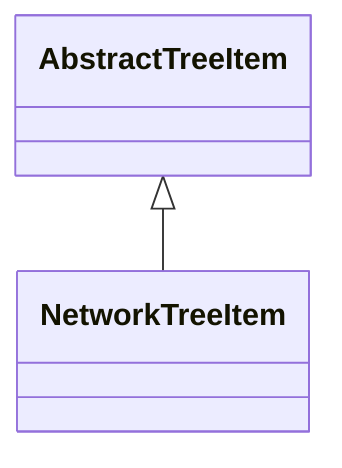

# NetworkTreeItem

**Namespace:** `mne::viz::qt` &nbsp;·&nbsp; **Library:** Visualization: Qt Backend &nbsp;·&nbsp; **Source:** [`viz/backends/qt/3d/model/items/networktreeitem.h`](https://github.com/mne-tools/mne-cpp/blob/staging/src/libs/mne/viz/backends/qt/3d/model/items/networktreeitem.h)

`#include <mne/viz/backends/qt/networktreeitem.h>`

```cpp
class mne::viz::qt::NetworkTreeItem
```

[`NetworkTreeItem`](/docs/api/viz-qt/network-tree-item) holds metadata about a connectivity network in the tree model.

Tree item representing a connectivity network.

### Inheritance



---

## Public Methods

### NetworkTreeItem(text, objectKey)

Constructs a [`NetworkTreeItem`](/docs/api/viz-qt/network-tree-item).

**Parameters:**

- **text** : *const QString &*
  Display text.

- **objectKey** : *const std::string &*
  Unique key (e.g. "net_coherence").

---

### objectKey()

Returns the object key identifying this network.

**Returns:**

- *std::string* — The object key.

---

## Authors of this file

- Christoph Dinh &lt;christoph.dinh@mne-cpp.org&gt;
