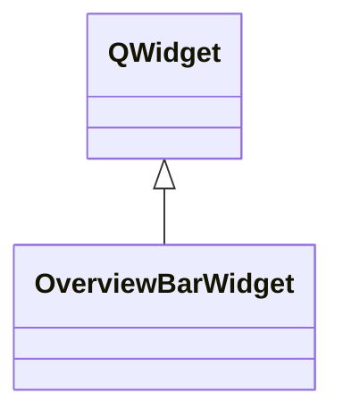

# OverviewBarWidget

**Namespace:** `mne::viz::qt` &nbsp;·&nbsp; **Library:** Visualization: Qt Backend &nbsp;·&nbsp; **Source:** [`viz/backends/qt/viewers/helpers/overviewbarwidget.h`](https://github.com/mne-tools/mne-cpp/blob/staging/src/libs/mne/viz/backends/qt/viewers/helpers/overviewbarwidget.h)

`#include <mne/viz/backends/qt/overviewbarwidget.h>`

```cpp
class mne::viz::qt::OverviewBarWidget
```

Minimap thumbnail of the entire recording shown above the raw browser.

Paints a compressed amplitude-overview of the whole acquisition next to a viewport rectangle indicating where the raw browser is currently positioned; clicks / drags emit `sampleClicked`.

### Inheritance



---

## Public Methods

### OverviewBarWidget(parent)

---

### setModel(model)

---

### setFirstFileSample(first)

---

### setLastFileSample(last)

---

### setSfreq(sfreq)

---

### setViewport(scrollSample, visibleSamples)

---

### setEvents(events)

---

### setAnnotations(annotations)

---

### sizeHint()

---

### minimumSizeHint()

---

## Authors of this file

- Christoph Dinh &lt;christoph.dinh@mne-cpp.org&gt;
