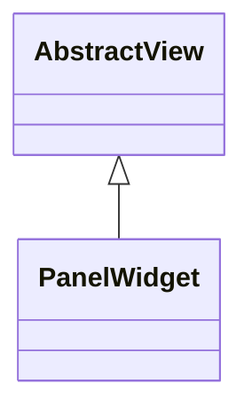

# PanelWidget

**Namespace:** `mne::viz::qt` &nbsp;·&nbsp; **Library:** Visualization: Qt Backend &nbsp;·&nbsp; **Source:** [`viz/backends/qt/kit/panelwidget.h`](https://github.com/mne-tools/mne-cpp/blob/staging/src/libs/mne/viz/backends/qt/kit/panelwidget.h)

`#include <mne/viz/backends/qt/panelwidget.h>`

```cpp
class mne::viz::qt::PanelWidget
```

The Qt host of every [`Panel`](/docs/api/viz/panel): its form as a [`SettingsPanel`](/docs/api/viz-qt/settings-panel), its title, width, modes and settings.

The widget shares the panel with its owner. It restores the panel from QSettings("MNECPP") under the settings path when it is created and stores it when it is destroyed.

### Inheritance



---

## Public Methods

### PanelWidget(panel, settingsPath, parent)

Shows a panel.

**Parameters:**

- **panel** : *std::shared_ptr&lt; [Panel](/docs/api/viz/panel) &gt;*
  The panel, shared with its owner.

- **settingsPath** : *const QString &*
  QSettings path of the host, e.g. "MNESCAN/NoiseReduction"; empty stores nothing.

- **parent** : *QWidget **
  Parent widget.

---

### ~PanelWidget()

---

### panel()

**Returns:**

- *[Panel](/docs/api/viz/panel) &* — The panel.

---

### formPanel()

**Returns:**

- *[SettingsPanel](/docs/api/viz-qt/settings-panel) ** — The widgets of the panel's form.

---

### setTheme(theme)

Gives the panel a theme; [`PanelWidget`](/docs/api/viz-qt/panel-widget) starts with `viz::Theme::light()`.

**Parameters:**

- **theme** : *const [Theme](/docs/api/viz/theme) &*
  Colours, fonts and metrics.

---

### saveSettings()

Saves all important settings of this view via QSettings.

---

### loadSettings()

Loads and inits all important settings of this view via QSettings.

---

### updateGuiMode(mode)

Update the views GUI based on the set GuiMode (Clinical=0, Research=1).

**Parameters:**

- **mode** : *GuiMode*
  The new mode (Clinical=0, Research=1).

---

### updateProcessingMode(mode)

Update the views GUI based on the set ProcessingMode (RealTime=0, Offline=1).

**Parameters:**

- **mode** : *ProcessingMode*
  The new mode (RealTime=0, Offline=1).

---

### clearView()

Clears the view.

---

## Example

No example of its own: Qt host of the toolkit-free viz::Panel classes, created by the MNE Scan plugins; exercised by test_viz_qt_viewers.

## Authors of this file

- Christoph Dinh &lt;christoph.dinh@mne-cpp.org&gt;
