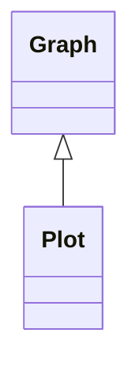

# Plot

**Namespace:** `mne::viz::qt` &nbsp;·&nbsp; **Library:** Visualization: Qt Backend &nbsp;·&nbsp; **Source:** [`viz/backends/qt/plots/plot.h`](https://github.com/mne-tools/mne-cpp/blob/staging/src/libs/mne/viz/backends/qt/plots/plot.h)

`#include <mne/viz/backends/qt/plot.h>`

```cpp
class mne::viz::qt::Plot
```

MATLAB-style line plot for an Eigen vector, derived from [`Graph`](/docs/api/viz-qt/graph).

Draws an [`VectorPlot`](/docs/api/viz/vector-plot), which renders without Qt as well. ``updateData()`` replaces the visible curve in place.

```cpp title="src/examples/ex_disp_plots/main.cpp"
VectorXd samples = VectorXd::LinSpaced(50, -1.0, 1.0);
Plot plot(samples); // Plot is a Graph with title and axis labels
plot.setTitle("ramp");
plot.setXLabel("sample");
plot.setYLabel("value");
```

### Inheritance



---

## Public Methods

### Plot(parent)

Creates the plot.

**Parameters:**

- **parent** : *QWidget **
  Parent QObject (optional).

---

### Plot(p_dVec, parent)

Creates the plot using a given double vector.

**Parameters:**

- **p_dVec** : *Eigen::VectorXd &*
  The double data vector.

- **parent** : *QWidget **
  Parent QObject (optional).

---

### ~Plot()

Destructs the [`Plot`](/docs/api/viz-qt/plot) object.

---

### init()

Initializes the [`Plot`](/docs/api/viz-qt/plot) object.

---

### updateData(p_dVec)

Updates the plot using a given double vector without given X data.

**Parameters:**

- **p_dVec** : *Eigen::VectorXd &*
  The double data vector.

---

## Example

- Start here: [ex_disp_plots](../../examples/viz_qt/ex_disp_plots.mdx) — Disp plots: colour maps, bar and spline histograms, line plots, image and time-frequency maps.
- Full source: [`src/examples/ex_disp_plots/main.cpp`](https://github.com/mne-tools/mne-cpp/tree/staging/src/examples/ex_disp_plots/main.cpp)
- Build target: `ex_disp_plots` (runs under CTest)

## Authors of this file

- Lorenz Esch &lt;lorenz.esch@tu-ilmenau.de&gt;
- Juan GPC &lt;jgarciaprieto@mgh.harvard.edu&gt;
- Gabriel Motta &lt;gabrielbenmotta@gmail.com&gt;
- Christoph Dinh &lt;christoph.dinh@mne-cpp.org&gt;
