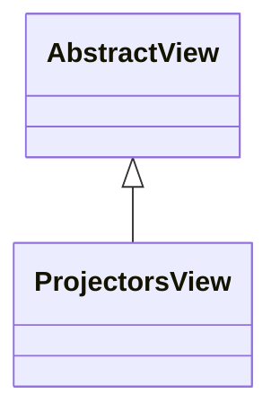

# ProjectorsView

**Namespace:** `mne::viz::qt` &nbsp;·&nbsp; **Library:** Visualization: Qt Backend &nbsp;·&nbsp; **Source:** [`viz/backends/qt/viewers/projectorsview.h`](https://github.com/mne-tools/mne-cpp/blob/staging/src/libs/mne/viz/backends/qt/viewers/projectorsview.h)

`#include <mne/viz/backends/qt/projectorsview.h>`

```cpp
class mne::viz::qt::ProjectorsView
```

SSP projector enable / disable checkbox list.

One `QCheckBox` per [`FiffProj`](/docs/api/fiff/fiff-proj) plus a master toggle; emits `projSelectionChanged` so the `rtprocessing` pipeline can (de)project the streaming data on the fly.

### Inheritance



---

## Public Methods

### ProjectorsView(sSettingsPath, parent, f)

Constructs a [`ProjectorsView`](/docs/api/viz-qt/projectors-view) which is a child of parent.

**Parameters:**

- **sSettingsPath** : *const QString &*
  Settings path under which the widget persists its state (empty = no persistence).

- **parent** : *QWidget **
  parent of widget.

- **f** : *Qt::WindowFlags*
  Qt window flags passed to the QWidget constructor.

---

### ~ProjectorsView()

Destroys the [`ProjectorsView`](/docs/api/viz-qt/projectors-view).

---

### getProjectors()

Get the current projectors.

**Returns:**

- *std::vector&lt; [FiffProj](/docs/api/fiff/fiff-proj) &gt;* — The current projectors.

---

### setProjectors(projs)

Set the current projectors.

**Parameters:**

- **projs** : *const std::vector&lt; [FiffProj](/docs/api/fiff/fiff-proj) &gt; &*
  The new projectors.

---

### redrawGUI()

Redraw the view.

---

### saveSettings()

Saves all important settings of this view via QSettings.

---

### loadSettings()

Loads and inits all important settings of this view via QSettings.

---

### clearView()

Clears the view.

---

## Authors of this file

- Lorenz Esch &lt;lorenz.esch@tu-ilmenau.de&gt;
- Gabriel Motta &lt;gabrielbenmotta@gmail.com&gt;
- Juan GPC &lt;jgarciaprieto@mgh.harvard.edu&gt;
- Andreas Griesshammer &lt;ag@fieldlineinc.com&gt;
- Christoph Dinh &lt;christoph.dinh@mne-cpp.org&gt;
