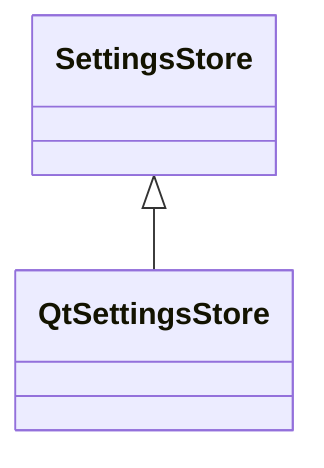

# QtSettingsStore

**Namespace:** `mne::viz::qt` &nbsp;·&nbsp; **Library:** Visualization: Qt Backend &nbsp;·&nbsp; **Source:** [`viz/backends/qt/qtsettingsstore.h`](https://github.com/mne-tools/mne-cpp/blob/staging/src/libs/mne/viz/backends/qt/qtsettingsstore.h)

`#include <mne/viz/backends/qt/qtsettingsstore.h>`

```cpp
class mne::viz::qt::QtSettingsStore
```

[`SettingsStore`](/docs/api/viz/settings-store) on a QSettings, which it does not own.

Booleans, integers and numbers are written as such, so settings written before keep their types.

### Inheritance



---

## Public Methods

### QtSettingsStore(settings)

**Parameters:**

- **settings** : *QSettings &*
  Settings to read and write; must outlive the store.

---

### value(key)

**Parameters:**

- **key** : *const std::string &*
  `Key`.

**Returns:**

- *std::optional&lt; viz::SettingValue &gt;* — The stored value, or nothing when `key` is absent.

---

### set_value(key, value)

Store `value` under `key`, replacing any previous value.

**Parameters:**

- **key** : *const std::string &*
  `Key`.

- **value** : *const viz::SettingValue &*
  Value.

---

## Example

No example of its own: Adapter of viz::SettingsStore onto QSettings that BrainView persists through; the example shows the store interface with MemorySettingsStore.

## Authors of this file

- Christoph Dinh &lt;christoph.dinh@mne-cpp.org&gt;
