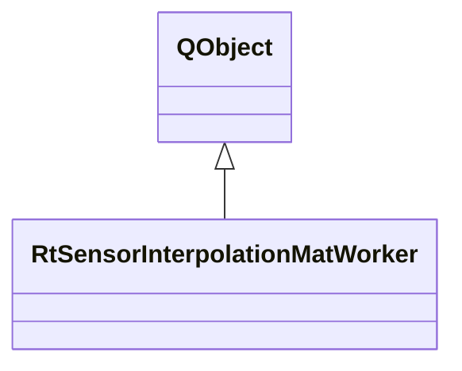

# RtSensorInterpolationMatWorker

**Namespace:** `mne::viz::qt` &nbsp;·&nbsp; **Library:** Visualization: Qt Backend &nbsp;·&nbsp; **Source:** [`viz/backends/qt/3d/workers/rtsensorinterpolationmatworker.h`](https://github.com/mne-tools/mne-cpp/blob/staging/src/libs/mne/viz/backends/qt/3d/workers/rtsensorinterpolationmatworker.h)

`#include <mne/viz/backends/qt/rtsensorinterpolationmatworker.h>`

```cpp
class mne::viz::qt::RtSensorInterpolationMatWorker
```

[`RtSensorInterpolationMatWorker`](/docs/api/viz-qt/rt-sensor-interpolation-mat-worker) computes dense sensor-to-surface field-mapping matrices in a background thread.

This worker encapsulates the expensive `mne::FwdFieldMap::computeMegMapping()` and computeEegMapping() calls that were previously performed synchronously on the main thread inside [BrainView](/docs/api/viz-qt/brain-view)::buildSensorFieldMapping().

The worker stores all relevant parameters (evoked info, surface geometry, transforms, etc.) and recomputes the mapping matrices when any parameter changes. It emits newMappingMatrixAvailable() when a new matrix is ready.

Thread-safety: all public setters are mutex-protected and schedule a recomputation via the `computeMapping()` slot.

Background worker for computing sensor field mapping matrices.

### Inheritance



---

## Public Methods

### RtSensorInterpolationMatWorker(parent)

Constructor.

**Parameters:**

- **parent** : *QObject **
  Parent QObject.

---

### setEvoked(evoked)

Set the evoked data that contains channel info and sensor definitions.

**Parameters:**

- **evoked** : *const [FiffEvoked](/docs/api/fiff/fiff-evoked) &*
  The evoked dataset.

---

### setTransform(trans, applySensorTrans)

Set the head-to-MRI coordinate transform.

**Parameters:**

- **trans** : *const [FiffCoordTrans](/docs/api/fiff/fiff-coord-trans) &*
  The transform.

- **applySensorTrans** : *bool*
  Whether to apply the transform.

---

### setMegFieldMapOnHead(onHead)

Set whether the MEG field should be mapped onto the head (BEM) surface rather than the helmet surface.

**Parameters:**

- **onHead** : *bool*
  True to map onto head.

---

### setMegSurface(surfaceKey, vertices, normals, triangles)

Set the surface geometry used for MEG field mapping.

This must include vertex positions and normals (for MEG).

**Parameters:**

- **surfaceKey** : *const std::string &*
  The key identifying the surface.

- **vertices** : *const Eigen::MatrixX3f &*
  Vertex positions (nVerts x 3).

- **normals** : *const Eigen::MatrixX3f &*
  Vertex normals (nVerts x 3).

- **triangles** : *const Eigen::MatrixX3i &*
  Triangle indices (nTris x 3).

---

### setEegSurface(surfaceKey, vertices)

Set the surface geometry used for EEG field mapping.

**Parameters:**

- **surfaceKey** : *const std::string &*
  The key identifying the surface.

- **vertices** : *const Eigen::MatrixX3f &*
  Vertex positions (nVerts x 3).

---

### setBadChannels(bads)

Set the bad channels.

Triggers recomputation if changed.

**Parameters:**

- **bads** : *const std::vector&lt; std::string &gt; &*
  List of bad channel names.

---

## Authors of this file

- Christoph Dinh &lt;christoph.dinh@mne-cpp.org&gt;
