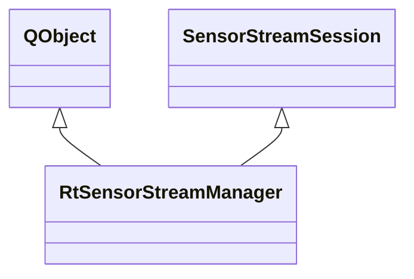

# RtSensorStreamManager

**Namespace:** `mne::viz::qt` &nbsp;·&nbsp; **Library:** Visualization: Qt Backend &nbsp;·&nbsp; **Source:** [`viz/backends/qt/3d/scene/rtsensorstreammanager.h`](https://github.com/mne-tools/mne-cpp/blob/staging/src/libs/mne/viz/backends/qt/3d/scene/rtsensorstreammanager.h)

`#include <mne/viz/backends/qt/rtsensorstreammanager.h>`

```cpp
class mne::viz::qt::RtSensorStreamManager
```

Qt face of [`SensorStreamSession`](/docs/api/viz/sensor-stream-session) as a QObject: the same API, with the results as signals on this object's thread.

### Inheritance



---

## Public Methods

### RtSensorStreamManager(parent)

Constructor.

**Parameters:**

- **parent** : *QObject **
  Parent QObject.

---

### ~RtSensorStreamManager()

Destructor.

---

## Example

No example of its own: Real-time sensor streaming state owned privately by BrainView; exercised through BrainView's streaming API (test_disp3d_brainview, test_sensor_streaming).

It is exercised by:

````cpp title="src/examples/ex_disp3d_scene/main.cpp"
BrainView view; // QRhi widget; nothing is rendered until it is shown
view.setViewCount(2);
const bool twoPanes = view.viewCount() == 2 && view.viewMode() == BrainView::MultiView;
LiveMarker trackerTip;
trackerTip.position = QVector3D(0.0f, 0.08f, 0.04f);
trackerTip.color = Qt::yellow;
view.setLiveMarkers({trackerTip}); // transient, does not move the camera
view.clearLiveMarkers();
view.setViewCount(1);
````

From [ex_disp3d_scene](../../examples/viz_qt/ex_disp3d_scene.mdx).

## Authors of this file

- Christoph Dinh &lt;christoph.dinh@mne-cpp.org&gt;
