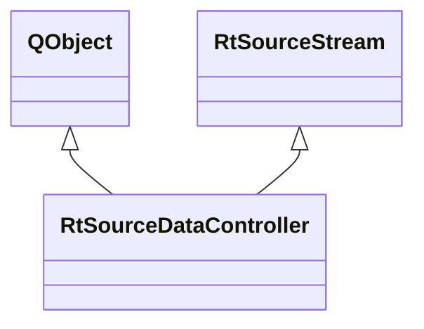

# RtSourceDataController

**Namespace:** `mne::viz::qt` &nbsp;·&nbsp; **Library:** Visualization: Qt Backend &nbsp;·&nbsp; **Source:** [`viz/backends/qt/3d/workers/rtsourcedatacontroller.h`](https://github.com/mne-tools/mne-cpp/blob/staging/src/libs/mne/viz/backends/qt/3d/workers/rtsourcedatacontroller.h)

`#include <mne/viz/backends/qt/rtsourcedatacontroller.h>`

```cpp
class mne::viz::qt::RtSourceDataController
```

Qt face of [`RtSourceStream`](/docs/api/viz/rt-source-stream) as a QObject: the same API, with the results as signals on this object's thread.

The streaming and interpolation threads of the stream hand their results over to this object's thread, so slots connected to the signals may touch the GUI.

### Inheritance



---

## Public Methods

### RtSourceDataController(parent)

Constructor.

**Parameters:**

- **parent** : *QObject **
  Parent QObject.

---

### ~RtSourceDataController()

Destructor.

Stops the threads of the stream before the signals go away.

---

## Authors of this file

- Christoph Dinh &lt;christoph.dinh@mne-cpp.org&gt;
