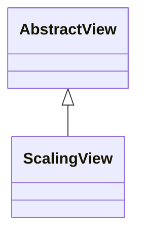

# ScalingView

**Namespace:** `mne::viz::qt` &nbsp;·&nbsp; **Library:** Visualization: Qt Backend &nbsp;·&nbsp; **Source:** [`viz/backends/qt/viewers/scalingview.h`](https://github.com/mne-tools/mne-cpp/blob/staging/src/libs/mne/viz/backends/qt/viewers/scalingview.h)

`#include <mne/viz/backends/qt/scalingview.h>`

```cpp
class mne::viz::qt::ScalingView
```

Per-modality y-scale spinbox panel built from [`ScaleControl`](/docs/api/viz-qt/scale-control) widgets.

One [`ScaleControl`](/docs/api/viz-qt/scale-control) per channel modality in the active [`FiffInfo`](/docs/api/fiff/fiff-info); edits are emitted as `scalingChanged` maps consumed by [`RtFiffRawView`](/docs/api/viz-qt/rt-fiff-raw-view), [`ChannelDataView`](/docs/api/viz-qt/channel-data-view) and [`ButterflyView`](/docs/api/viz-qt/butterfly-view).

### Inheritance



---

## Public Methods

### ScalingView(sSettingsPath, parent, f, lChannelsToShow)

Constructs a [`ScalingView`](/docs/api/viz-qt/scaling-view) which is a child of parent.

**Parameters:**

- **sSettingsPath** : *const QString &*
  Settings path under which the widget persists its state (empty = no persistence).

- **parent** : *QWidget **
  Parent of widget.

- **f** : *Qt::WindowFlags*
  Qt window flags passed to the QWidget constructor.

- **lChannelsToShow** : *const std::vector&lt; std::string &gt; &*
  Channel types to show scaling controls for ("all" = every type).

---

### ~ScalingView()

Destroys the [`ScalingView`](/docs/api/viz-qt/scaling-view).

---

### getScaleMap()

Get the current scaling map.

**Returns:**

- *std::map&lt; int, float &gt;* — The current scaling map.

---

### setScaleMap(qMapChScaling)

Set the current scaling map.

This also recreates the GUI.

**Parameters:**

- **qMapChScaling** : *const std::map&lt; int, float &gt; &*
  Map from FIFF channel kind/unit key to amplitude scale.

---

### saveSettings()

Saves all important settings of this view via QSettings.

---

### loadSettings()

Loads and inits all important settings of this view via QSettings.

---

### clearView()

Clears the view.

---

### setMagGradLink(l)

Link the Magnetometers to the Gradiometers scale.

**Parameters:**

- **l** : *Qt::CheckState*
  Set the link between MAGs and GRADs active or inactive.

---

## Authors of this file

- Lorenz Esch &lt;lorenz.esch@tu-ilmenau.de&gt;
- Gabriel Motta &lt;gabrielbenmotta@gmail.com&gt;
- Wayne F. Mead &lt;isk@imsorrykun.com&gt;
- Juan GPC &lt;jgarciaprieto@mgh.harvard.edu&gt;
- Christoph Dinh &lt;christoph.dinh@mne-cpp.org&gt;
