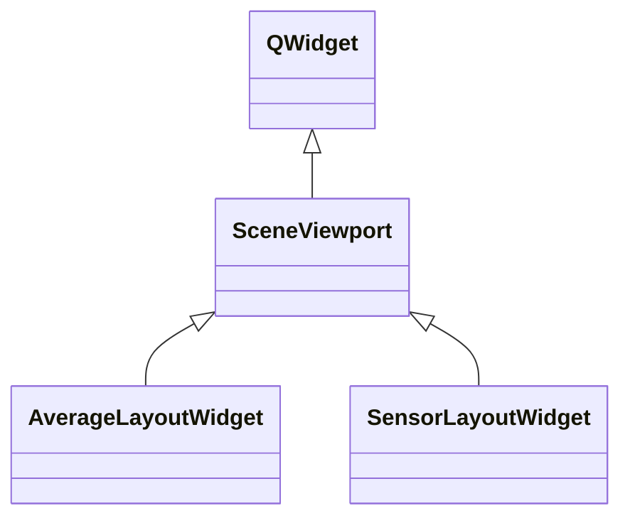

# SceneViewport

**Namespace:** `mne::viz::qt` &nbsp;·&nbsp; **Library:** Visualization: Qt Backend &nbsp;·&nbsp; **Source:** [`viz/backends/qt/viewers/helpers/sceneviewport.h`](https://github.com/mne-tools/mne-cpp/blob/staging/src/libs/mne/viz/backends/qt/viewers/helpers/sceneviewport.h)

`#include <mne/viz/backends/qt/sceneviewport.h>`

```cpp
class mne::viz::qt::SceneViewport
```

Base of the widgets that show a scene model, such as a sensor layout, with zoom, pan and rubber band.

Subclasses report the area of their contents in `sceneBounds()`, draw them in `drawScene()` and react to clicks and bands in `scenePressed()` and `sceneBandSelected()`.

### Inheritance



---

## Public Methods

### SceneViewport(parent)

Constructs an empty viewport with a white background.

**Parameters:**

- **parent** : *QWidget **
  Parent widget.

---

### setBackgroundColor(color)

**Parameters:**

- **color** : *const QColor &*
  Colour behind the contents.

---

### backgroundColor()

**Returns:**

- *QColor* — The colour behind the contents.

---

### fitToContents()

Fits the contents into the widget, keeping their aspect ratio, and keeps them fitted as the widget resizes until the user zooms or pans.

---

### isFitted()

**Returns:**

- *bool* — Whether the contents are kept fitted.

---

### zoom()

**Returns:**

- *double* — Pixels per scene unit.

---

### zoomBy(factor, anchor)

Zooms by `factor`, keeping the scene point under `anchor` in place.

**Parameters:**

- **factor** : *double*
  Factor, above 1 to zoom in.

- **anchor** : *const QPointF &*
  Fixed point in widget coordinates.

---

### panBy(pixels)

Moves the contents.

**Parameters:**

- **pixels** : *const QPointF &*
  Offset in widget pixels.

---

### mapToScene(point)

**Parameters:**

- **point** : *const QPointF &*
  [`Point`](/docs/api/viz/point) in widget coordinates.

**Returns:**

- *[Point](/docs/api/viz/point)* — The point in scene coordinates.

---

### mapFromScene(point)

**Parameters:**

- **point** : *[Point](/docs/api/viz/point)*
  [`Point`](/docs/api/viz/point) in scene coordinates.

**Returns:**

- *QPointF* — The point in widget coordinates.

---

### figure(size)

The contents fitted into a figure, e.g.

to export them with `viz::write_svg()`.

**Parameters:**

- **size** : *const QSize &*
  Size of the figure in pixels.

**Returns:**

- *[DisplayList](/docs/api/viz/display-list)* — The figure on the background colour.

---

## Example

No example of its own: Abstract base of SensorLayoutWidget and AverageLayoutWidget; its zoom, pan and rubber band are tested through them in test_viz_qt_viewers2.

## Authors of this file

- Christoph Dinh &lt;christoph.dinh@mne-cpp.org&gt;
