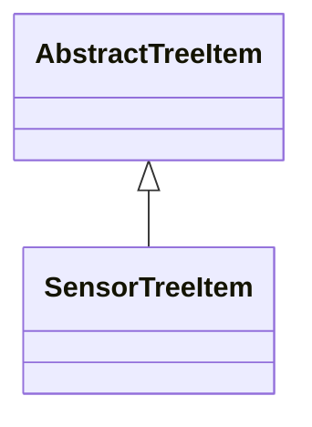

# SensorTreeItem

**Namespace:** `mne::viz::qt` &nbsp;·&nbsp; **Library:** Visualization: Qt Backend &nbsp;·&nbsp; **Source:** [`viz/backends/qt/3d/model/items/sensortreeitem.h`](https://github.com/mne-tools/mne-cpp/blob/staging/src/libs/mne/viz/backends/qt/3d/model/items/sensortreeitem.h)

`#include <mne/viz/backends/qt/sensortreeitem.h>`

```cpp
class mne::viz::qt::SensorTreeItem
```

Tree item representing MEG or EEG sensor positions in the 3-D scene hierarchy.

### Inheritance



---

## Public Methods

### SensorTreeItem(text, pos, color, scale, type)

---

### ~SensorTreeItem()

---

### position()

---

### scale()

---

### setOrientation(orient)

Set the coil orientation matrix (3x3 rotation from coil_trans).

**Parameters:**

- **orient** : *const QMatrix4x4 &*
  Coil rotation stored in the upper-left 3x3 of a 4x4 matrix.

---

### orientation()

Returns the coil orientation (identity if not set).

**Returns:**

- *const QMatrix4x4 &* — Reference to the stored coil orientation matrix.

---

### hasOrientation()

Returns true if an explicit orientation was set.

**Returns:**

- *bool* — True once `setOrientation()` has been called.

---

## Authors of this file

- Christoph Dinh &lt;christoph.dinh@mne-cpp.org&gt;
