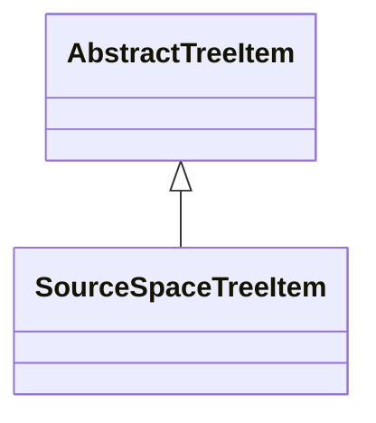

# SourceSpaceTreeItem

**Namespace:** `mne::viz::qt` &nbsp;·&nbsp; **Library:** Visualization: Qt Backend &nbsp;·&nbsp; **Source:** [`viz/backends/qt/3d/model/items/sourcespacetreeitem.h`](https://github.com/mne-tools/mne-cpp/blob/staging/src/libs/mne/viz/backends/qt/3d/model/items/sourcespacetreeitem.h)

`#include <mne/viz/backends/qt/sourcespacetreeitem.h>`

```cpp
class mne::viz::qt::SourceSpaceTreeItem
```

[`SourceSpaceTreeItem`](/docs/api/viz-qt/source-space-tree-item) represents a single source space point in the tree model.

Each item stores its 3D position and rendering scale.

Source space point tree item.

### Inheritance



---

## Public Methods

### SourceSpaceTreeItem(text, positions, color, scale, type)

Constructs a [`SourceSpaceTreeItem`](/docs/api/viz-qt/source-space-tree-item) for a hemisphere.

**Parameters:**

- **text** : *const QString &*
  Display text for the item (e.g. "LH", "RH").

- **positions** : *const std::vector&lt; QVector3D &gt; &*
  3D positions of all source points in this hemisphere (in meters).

- **color** : *const QColor &*
  [`Color`](/docs/api/viz/color) for rendering.

- **scale** : *float*
  Radius/size of each rendered sphere.

- **type** : *int*
  Item type identifier.

---

### ~SourceSpaceTreeItem()

---

### positions()

Returns all source point positions.

**Returns:**

- *const std::vector&lt; QVector3D &gt; &* — Vector of position vectors.

---

### scale()

Returns the rendering scale.

**Returns:**

- *float* — Scale value.

---

## Authors of this file

- Christoph Dinh &lt;christoph.dinh@mne-cpp.org&gt;
