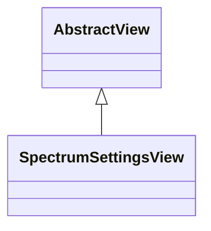

# SpectrumSettingsView

**Namespace:** `mne::viz::qt` &nbsp;·&nbsp; **Library:** Visualization: Qt Backend &nbsp;·&nbsp; **Source:** [`viz/backends/qt/viewers/spectrumsettingsview.h`](https://github.com/mne-tools/mne-cpp/blob/staging/src/libs/mne/viz/backends/qt/viewers/spectrumsettingsview.h)

`#include <mne/viz/backends/qt/spectrumsettingsview.h>`

```cpp
class mne::viz::qt::SpectrumSettingsView
```

Lower / upper-bound frequency sliders for the FFT spectrum viewer.

Two `QSliders` emit `lowerFreqChanged` / `upperFreqChanged` so the connected [`SpectrumPanel`](/docs/api/viz/spectrum-panel) can crop the displayed frequency axis.

### Inheritance



---

## Public Methods

### SpectrumSettingsView(sSettingsPath, parent, f)

Constructs a [`SpectrumSettingsView`](/docs/api/viz-qt/spectrum-settings-view) which is a child of parent.

**Parameters:**

- **sSettingsPath** : *const QString &*
  Settings path under which the widget persists its state (empty = no persistence).

- **parent** : *QWidget **
  parent of widget.

- **f** : *Qt::WindowFlags*
  Qt window flags passed to the QWidget constructor.

---

### ~SpectrumSettingsView()

Destroys the [`SpectrumSettingsView`](/docs/api/viz-qt/spectrum-settings-view).

---

### updateValue(value)

Update slider value.

**Parameters:**

- **value** : *qint32*
  slider value.

---

### saveSettings()

Saves all important settings of this view via QSettings.

---

### loadSettings()

Loads and inits all important settings of this view via QSettings.

---

### setBoundaries(fSFreq, fLowerBound, fUpperBound)

Sets the sampling frequency as well as boundaries and configure the GUI elements accordingly.

**Parameters:**

- **fSFreq** : *float*
  The sampling frequency.

- **fLowerBound** : *float*
  The lower bound of the spectrum.

- **fUpperBound** : *float*
  The upper bound of the spectrum.

---

### getLowerBound()

Returns the lower bound.

**Returns:**

- *float* — Returns the lower bound as a float.

---

### getUpperBound()

Returns the upper bound.

**Returns:**

- *float* — Returns the upper bound as a float.

---

### clearView()

Clears the view.

---

## Authors of this file

- Christoph Dinh &lt;christoph.dinh@mne-cpp.org&gt;
- Matti Hamalainen &lt;msh@nmr.mgh.harvard.edu&gt;
- Lorenz Esch &lt;lorenz.esch@tu-ilmenau.de&gt;
- Gabriel Motta &lt;gabrielbenmotta@gmail.com&gt;
- Juan GPC &lt;jgarciaprieto@mgh.harvard.edu&gt;
