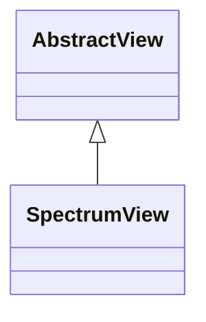

# SpectrumView

**Namespace:** `mne::viz::qt` &nbsp;·&nbsp; **Library:** Visualization: Qt Backend &nbsp;·&nbsp; **Source:** [`viz/backends/qt/viewers/spectrumview.h`](https://github.com/mne-tools/mne-cpp/blob/staging/src/libs/mne/viz/backends/qt/viewers/spectrumview.h)

`#include <mne/viz/backends/qt/spectrumview.h>`

```cpp
class mne::viz::qt::SpectrumView
```

Per-channel frequency-spectrum heat-map QTableView (rows = channels, columns = freq bins).

Wraps a `QTableView` around a [`FrequencySpectrumModel`](/docs/api/viz-qt/frequency-spectrum-model) and paints each row with [`FrequencySpectrumDelegate`](/docs/api/viz-qt/frequency-spectrum-delegate) so the live FFT amplitudes appear as a rolling colour band per channel.

### Inheritance



---

## Public Methods

### SpectrumView(sSettingsPath, parent, f)

Constructs a [`SpectrumView`](/docs/api/viz-qt/spectrum-view) which is a child of parent.

**Parameters:**

- **sSettingsPath** : *const QString &*
  Settings path under which the widget persists its state (empty = no persistence).

- **parent** : *QWidget **
  parent of widget.

- **f** : *Qt::WindowFlags*
  Qt window flags passed to the QWidget constructor.

---

### ~SpectrumView()

Destroys the [`ArtifactSettingsView`](/docs/api/viz-qt/artifact-settings-view).

---

### init(info, iScaleType)

Initializes the view based on the [`FiffInfo`](/docs/api/fiff/fiff-info) and scale type.

**Parameters:**

- **info** : *std::shared_ptr&lt; [FiffInfo](/docs/api/fiff/fiff-info) &gt; &*
  The [`FiffInfo`](/docs/api/fiff/fiff-info).

- **iScaleType** : *int*
  The scale type.

---

### addData(matData)

Adds data to the underlying model.

**Parameters:**

- **matData** : *const Eigen::MatrixXd &*
  The new data.

---

### setBoundaries(iLower, iUpper)

Sets the boundaries.

**Parameters:**

- **iLower** : *int*
  The lower boundary.

- **iUpper** : *int*
  The upper boundary.

---

### eventFilter(watched, event)

The event filter.

**Parameters:**

- **watched** : *QObject **
  Object the event was sent to.

- **event** : *QEvent **
  The intercepted event.

**Returns:**

- *bool* — True if a mouse-move event was consumed, otherwise the QWidget result.

---

### saveSettings()

Saves all important settings of this view via QSettings.

---

### loadSettings()

Loads and inits all important settings of this view via QSettings.

---

### clearView()

Clears the view.

---

## Authors of this file

- Christoph Dinh &lt;christoph.dinh@mne-cpp.org&gt;
- Matti Hamalainen &lt;msh@nmr.mgh.harvard.edu&gt;
- Lorenz Esch &lt;lorenz.esch@tu-ilmenau.de&gt;
- Gabriel Motta &lt;gabrielbenmotta@gmail.com&gt;
- Juan GPC &lt;jgarciaprieto@mgh.harvard.edu&gt;
