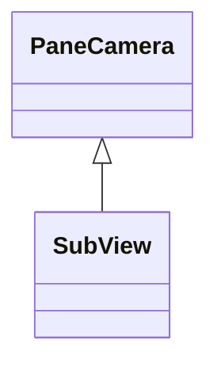

# SubView

**Namespace:** `mne::viz::qt` &nbsp;·&nbsp; **Library:** Visualization: Qt Backend &nbsp;·&nbsp; **Source:** [`viz/backends/qt/3d/core/viewstate.h`](https://github.com/mne-tools/mne-cpp/blob/staging/src/libs/mne/viz/backends/qt/3d/core/viewstate.h)

`#include <mne/viz/backends/qt/viewstate.h>`

```cpp
struct mne::viz::qt::SubView
```

Viewport subdivision holding its own camera, projection, and scissor rectangle.

Encapsulates all per-view state for a single viewport (single view or one pane in multi-view).

The class stores shader, surface type, overlay mode, visibility flags, and, through its toolkit-neutral [`PaneCamera`](/docs/api/viz/pane-camera) base, the zoom, pan, camera rotation and view preset — everything that can differ between two viewports showing the same scene.

### Inheritance



---

## Public Methods

### matchesSurfaceType(key)

True when the brain-surface `key` matches this view's surfaceType (e.g.

"lh_pial" matches surfaceType "pial").

**Parameters:**

- **key** : *std::string_view*
  [`Surface`](/docs/api/viz/surface) map key to test.

**Returns:**

- *bool* — True if the key is a brain surface key ending with surfaceType.

---

### shouldRenderSurface(key)

True when the surface identified by `key` should be rendered according to this view's visibility profile.

**Parameters:**

- **key** : *std::string_view*
  [`Surface`](/docs/api/viz/surface) map key to test.

**Returns:**

- *bool* — True if the visibility profile enables this surface; unknown keys return true.

---

### applyOverlayToSurfaces(surfaces)

Apply this view's overlayMode to every brain surface whose key matches surfaceType.

Non-brain surfaces are never touched.

**Parameters:**

- **surfaces** : *std::map&lt; std::string, std::shared_ptr&lt; [BrainSurface](/docs/api/viz-qt/brain-surface) &gt; &gt; &*
  [`Surface`](/docs/api/viz/surface) map keyed by surface name; matching surfaces get their visualization mode updated.

---

### load(settings, prefix, fallbackRotation)

Load this [`SubView`](/docs/api/viz-qt/sub-view)'s state from QSettings under the given prefix.

**Parameters:**

- **settings** : *const QSettings &*
  Settings store to read from.

- **prefix** : *const QString &*
  `Key` prefix (e.g. "multi0_").

- **fallbackRotation** : *const Eigen::Quaternionf &*
  Rotation to use if no saved quaternion exists.

---

### save(settings, prefix)

Save this [`SubView`](/docs/api/viz-qt/sub-view)'s state to QSettings under the given prefix.

**Parameters:**

- **settings** : *QSettings &*
  Settings store to write to.

- **prefix** : *const QString &*
  `Key` prefix (e.g. "multi0_").

---

## Static Methods

### isBrainSurfaceKey(key)

True when `key` identifies a brain-tissue surface (lh_/rh_) as opposed to BEM, sensor, digitizer, or source-space geometry.

**Parameters:**

- **key** : *std::string_view*
  [`Surface`](/docs/api/viz/surface) map key to classify.

**Returns:**

- *bool* — True if the key is non-empty and has no bem_, sens_, srcsp_ or dig_ prefix.

---

### defaultForIndex(index)

Return default [`SubView`](/docs/api/viz-qt/sub-view) configuration for viewport `index`.

The preset cycles through the 7 camera orientations (Top, Perspective, Front, Left, Bottom, Back, Right) and the shader cycles through Anatomical → Standard → Holographic.

**Parameters:**

- **index** : *int*
  Zero-based viewport index.

**Returns:**

- *[SubView](/docs/api/viz-qt/sub-view)* — Enabled [`SubView`](/docs/api/viz-qt/sub-view) with preset index % 7 and the cycled brain shader.

---

## Authors of this file

- Christoph Dinh &lt;christoph.dinh@mne-cpp.org&gt;
