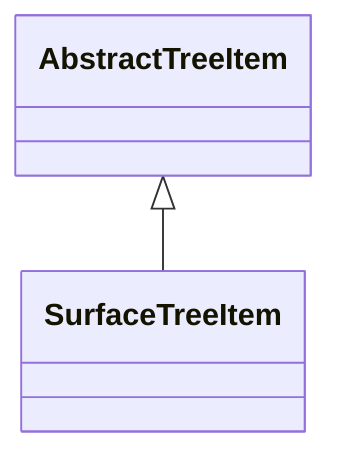

# SurfaceTreeItem

**Namespace:** `mne::viz::qt` &nbsp;·&nbsp; **Library:** Visualization: Qt Backend &nbsp;·&nbsp; **Source:** [`viz/backends/qt/3d/model/items/surfacetreeitem.h`](https://github.com/mne-tools/mne-cpp/blob/staging/src/libs/mne/viz/backends/qt/3d/model/items/surfacetreeitem.h)

`#include <mne/viz/backends/qt/surfacetreeitem.h>`

```cpp
class mne::viz::qt::SurfaceTreeItem
```

Tree item representing a FreeSurfer cortical surface in the 3-D scene hierarchy.

### Inheritance



---

## Public Methods

### SurfaceTreeItem(text)

---

### ~SurfaceTreeItem()

---

### setSurfaceData(surface)

---

### setAnnotationData(annotation)

---

### setShaderMode(mode)

---

### surfaceData()

---

### annotationData()

---

### shaderMode()

---

## Authors of this file

- Christoph Dinh &lt;christoph.dinh@mne-cpp.org&gt;
