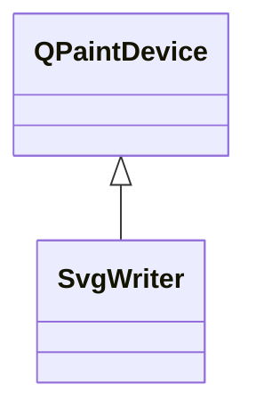

# SvgWriter

**Namespace:** `mne::viz::qt` &nbsp;·&nbsp; **Library:** Visualization: Qt Backend &nbsp;·&nbsp; **Source:** [`viz/backends/qt/plots/helpers/svgwriter.h`](https://github.com/mne-tools/mne-cpp/blob/staging/src/libs/mne/viz/backends/qt/plots/helpers/svgwriter.h)

`#include <mne/viz/backends/qt/svgwriter.h>`

```cpp
class mne::viz::qt::SvgWriter
```

Paint device that writes an SVG 1.1 document.

Paint on it with a single QPainter; render widgets with QWidget::render(QPainter*) so that all children share that painter and end up in one document.

```cpp title="src/examples/ex_disp_plots/main.cpp"
QBuffer svgBuffer; // or svg.setFileName("line_plot.svg")
SvgWriter svg;
svg.setOutputDevice(&svgBuffer);
svg.setSize(line.size());
svg.setTitle("LinePlot");
QPainter svgPainter(&svg);
line.render(&svgPainter); // render(QPainter*) keeps child widgets in the same document
svgPainter.end();
```

### Inheritance



---

## Public Methods

### SvgWriter()

Constructs a writer with neither a file name nor an output device.

---

### ~SvgWriter()

Destroys the writer.

---

### SvgWriter()

---

### operator=()

---

### setFileName(fileName)

Writes the document to the file `fileName`; clears a previously set output device.

**Parameters:**

- **fileName** : *const std::string &*
  Path of the SVG file, UTF-8.

---

### fileName()

Returns the file the document is written to, or an empty string when an output device is used.

**Returns:**

- *std::string* — The file name.

---

### setOutputDevice(device)

Writes the document to `device`, which stays owned by the caller; clears a previously set file name.

The device is opened for writing when it is not open yet.

**Parameters:**

- **device** : *QIODevice **
  The output device.

---

### outputDevice()

Returns the output device, or nullptr when a file name is used.

**Returns:**

- *QIODevice ** — The output device.

---

### setSize(size)

Sets the size of the document in pixels; it is the size of the paint device.

**Parameters:**

- **size** : *const QSize &*
  The size.

---

### size()

Returns the size of the document; the size of the view box when no size is set.

**Returns:**

- *QSize* — The size.

---

### setViewBox(viewBox)

Sets the part of the painting coordinate system that is shown; (0, 0, size) by default.

**Parameters:**

- **viewBox** : *const QRectF &*
  The view box.

---

### setViewBox(viewBox)

Sets the part of the painting coordinate system that is shown; (0, 0, size) by default.

**Parameters:**

- **viewBox** : *const QRect &*
  The view box.

---

### viewBox()

Returns the view box.

**Returns:**

- *QRectF* — The view box set, or (0, 0, size) when none is set.

---

### setTitle(title)

Sets the text of the document's title element.

**Parameters:**

- **title** : *const std::string &*
  The title; no title element is written when it is empty.

---

### title()

Returns the title.

**Returns:**

- *std::string* — The title.

---

### setDescription(description)

Sets the text of the document's desc element.

**Parameters:**

- **description** : *const std::string &*
  The description; no desc element is written when it is empty.

---

### description()

Returns the description.

**Returns:**

- *std::string* — The description.

---

### setResolution(dpi)

Sets the resolution the device reports, which converts font point sizes to pixels; 72 dpi by default.

**Parameters:**

- **dpi** : *int*
  Dots per inch.

---

### resolution()

Returns the resolution.

**Returns:**

- *int* — Dots per inch.

---

### paintEngine()

Returns the paint engine that writes the SVG elements.

**Returns:**

- *QPaintEngine ** — The paint engine, owned by the writer.

---

## Example

- Start here: [ex_disp_plots](../../examples/viz_qt/ex_disp_plots.mdx) — Disp plots: colour maps, bar and spline histograms, line plots, image and time-frequency maps.
- Full source: [`src/examples/ex_disp_plots/main.cpp`](https://github.com/mne-tools/mne-cpp/tree/staging/src/examples/ex_disp_plots/main.cpp)
- Build target: `ex_disp_plots` (runs under CTest)

## Authors of this file

- Christoph Dinh &lt;christoph.dinh@mne-cpp.org&gt;
