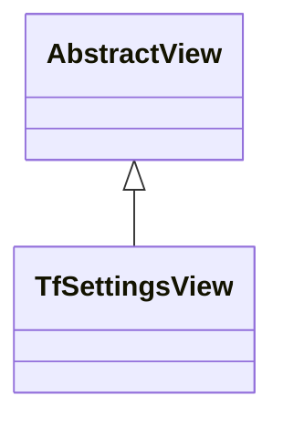

# TfSettingsView

**Namespace:** `mne::viz::qt` &nbsp;·&nbsp; **Library:** Visualization: Qt Backend &nbsp;·&nbsp; **Source:** [`viz/backends/qt/viewers/tfsettingsview.h`](https://github.com/mne-tools/mne-cpp/blob/staging/src/libs/mne/viz/backends/qt/viewers/tfsettingsview.h)

`#include <mne/viz/backends/qt/tfsettingsview.h>`

```cpp
class mne::viz::qt::TfSettingsView
```

Time-frequency analysis configuration panel (trials, window length, overlap).

Spinboxes drive the on-line STFT / Wavelet estimator; values are emitted as Qt signals on every edit.

### Inheritance



---

## Public Methods

### TfSettingsView(sSettingsPath, parent, f)

Constructs a [`TfSettingsView`](/docs/api/viz-qt/tf-settings-view) which is a child of parent.

**Parameters:**

- **sSettingsPath** : *const QString &*
  Settings path under which the widget persists its state (empty = no persistence).

- **parent** : *QWidget **
  parent of widget.

- **f** : *Qt::WindowFlags*
  Qt window flags passed to the QWidget constructor.

---

### ~TfSettingsView()

Destroys the [`TfSettingsView`](/docs/api/viz-qt/tf-settings-view).

---

### saveSettings()

Saves all important settings of this view via QSettings.

---

### loadSettings()

Loads and inits all important settings of this view via QSettings.

---

### clearView()

Clears the view.

---

## Authors of this file

- Lorenz Esch &lt;lorenz.esch@tu-ilmenau.de&gt;
- Gabriel Motta &lt;gabrielbenmotta@gmail.com&gt;
- Juan GPC &lt;jgarciaprieto@mgh.harvard.edu&gt;
- Christoph Dinh &lt;christoph.dinh@mne-cpp.org&gt;
