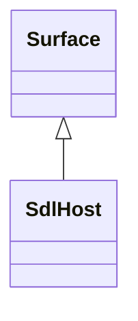

# SdlHost

**Namespace:** `mne::viz::sdl` &nbsp;·&nbsp; **Library:** Visualization: SDL Backend &nbsp;·&nbsp; **Source:** [`viz/backends/sdl/sdl_host.h`](https://github.com/mne-tools/mne-cpp/blob/staging/src/libs/mne/viz/backends/sdl/sdl_host.h)

`#include <mne/viz/backends/sdl/sdl_host.h>`

```cpp
class mne::viz::sdl::SdlHost
```

An SDL3 window that hosts a [`SurfaceClient`](/docs/api/viz/surface-client).

```cpp title="src/examples/ex_scene_sdl/main.cpp"
sdl::SdlHost host(options);
if (!host.is_open()) {
    std::fprintf(stderr, "Cannot open the window: %s\n", host.error().c_str());
    return 1;
}
```

### Inheritance



---

## Public Methods

### SdlHost(options)

Initialises SDL's video subsystem and opens the window.

Check `is_open()` afterwards.

**Parameters:**

- **options** : *Options*
  Window and loop settings.

---

### ~SdlHost()

Closes the window and shuts SDL down.

---

### SdlHost()

---

### operator=()

---

### is_open()

**Returns:**

- *bool* — Whether the window could be opened.

---

### error()

**Returns:**

- *const std::string &* — SDL's message when the window could not be opened.

---

### set_key_handler(handler)

Sets a handler that sees key presses before the client, e.g.

for the application's shortcuts.

**Parameters:**

- **handler** : *std::function&lt; bool(const [KeyEvent](/docs/api/viz/key-event) &)&gt;*
  Returns whether it used the key; Escape closes the window when nobody uses it.

---

### run(client, before_frame)

Shows `client` and runs the event loop until the window closes, Escape is pressed or the frame limit is reached.

**Parameters:**

- **client** : *[SurfaceClient](/docs/api/viz/surface-client) &*
  The view to show; attached for the duration of the call.

- **before_frame** : *const std::function&lt; void(std::int64_t)&gt; &*
  Called with the clock before each frame, e.g. to stream new data in.

**Returns:**

- *int* — The number of frames drawn.

---

### request_update()

Asks for a new frame; the host calls `SurfaceClient::frame()` soon, at most once per display refresh.

---

### set_cursor(shape)

Shows another pointer shape over the surface.

**Parameters:**

- **shape** : *CursorShape*
  The pointer shape.

---

### now_ms()

**Returns:**

- *std::int64_t* — Milliseconds of a monotonic clock, the time base of the input events and animations.

---

## Example

- Start here: [ex_scene_sdl](../../examples/viz/ex_scene_sdl.mdx) — Trace view in an SDL3 window, without Qt: mne_scene's view and software renderer in another toolkit.
- Full source: [`src/examples/ex_scene_sdl/main.cpp`](https://github.com/mne-tools/mne-cpp/tree/staging/src/examples/ex_scene_sdl/main.cpp)
- Build target: `ex_scene_sdl` (runs under CTest)

## Authors of this file

- Christoph Dinh &lt;christoph.dinh@mne-cpp.org&gt;
