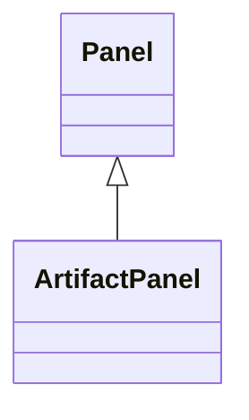

# ArtifactPanel

**Namespace:** `mne::viz` &nbsp;·&nbsp; **Library:** Visualization Library &nbsp;·&nbsp; **Source:** [`viz/panels/artifact_panel.h`](https://github.com/mne-tools/mne-cpp/blob/staging/src/libs/mne/viz/panels/artifact_panel.h)

`#include <mne/viz/artifact_panel.h>`

```cpp
class mne::viz::ArtifactPanel
```

Tool panel of the artifact rejection: whether it is active and, for each channel type present (grad, mag, eeg, ecg, emg, eog), a peak-to-peak threshold as mantissa and decimal exponent.

The thresholds go out as a map by channel type plus "Active" (1 or 0). The settings keep the keys of the former ArtifactSettingsView.

### Inheritance



---

## Public Methods

### ArtifactPanel(channels)

**Parameters:**

- **channels** : *const std::vector&lt; [FiffChInfo](/docs/api/fiff/fiff-ch-info) &gt; &*
  The channels whose types get a threshold.

---

### ~ArtifactPanel()

---

### set_thresholds_callback(callback)

**Parameters:**

- **callback** : *std::function&lt; void(const std::map&lt; std::string, double &gt; &thresholds)&gt;*
  Called with the thresholds when the user changes them or the channels change.

---

### set_channels(channels)

Shows the channel types of `channels` and reports the thresholds.

**Parameters:**

- **channels** : *const std::vector&lt; [FiffChInfo](/docs/api/fiff/fiff-ch-info) &gt; &*
  The channels whose types get a threshold.

---

### thresholds()

**Returns:**

- *std::map&lt; std::string, double &gt;* — The thresholds by channel type, and "Active".

---

### rejection_active()

**Returns:**

- *bool* — Whether rejection is active and a channel type has a threshold.

---

### load(store, path)

Restores the settings without reporting them.

**Parameters:**

- **store** : *const [SettingsStore](/docs/api/viz/settings-store) &*
  Settings store.

- **path** : *const std::string &*
  Settings path.

---

## Example

No example of its own: Tool panel of an MNE Scan and MNE Analyze plugin, shown by the backends' panel hosts; works like CompensatorPanel, whose example shows the pattern.

## Authors of this file

- Christoph Dinh &lt;christoph.dinh@mne-cpp.org&gt;
