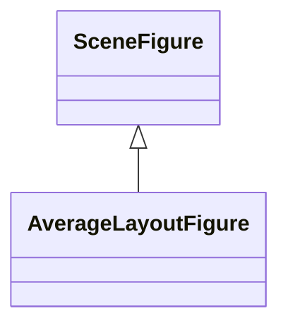

# AverageLayoutFigure

**Namespace:** `mne::viz` &nbsp;·&nbsp; **Library:** Visualization Library &nbsp;·&nbsp; **Source:** [`viz/figures/average_layout_figure.h`](https://github.com/mne-tools/mne-cpp/blob/staging/src/libs/mne/viz/figures/average_layout_figure.h)

`#include <mne/viz/average_layout_figure.h>`

```cpp
class mne::viz::AverageLayoutFigure
```

Channels as tiles of their averages at their layout positions; pressing a tile enlarges its name.

Each average is scaled by the channel's entry in the scale map, coloured by its comment and drawn only if its comment is active.

### Inheritance



---

## Public Methods

### set_channels(channels)

Sets the channels.

**Parameters:**

- **channels** : *std::vector&lt; Channel &gt;*
  The channels.

---

### channels()

**Returns:**

- *const std::vector&lt; Channel &gt; &* — The channels.

---

### channels()

Gives access to the channels to change their data; call `refresh()` afterwards.

**Returns:**

- *std::vector&lt; Channel &gt; &* — The channels.

---

### refresh()

Tells the hosts that the channels changed through `channels()`.

---

### set_scale_map(scales)

**Parameters:**

- **scales** : *std::map&lt; int, float &gt;*
  Value at the top edge of a tile, by channel kind, or by unit for MEG.

---

### set_average_activation(activation)

**Parameters:**

- **activation** : *std::map&lt; std::string, bool &gt;*
  Whether each average, by comment, is drawn; averages missing here are.

---

### set_average_colors(colors)

**Parameters:**

- **colors** : *std::map&lt; std::string, [Color](/docs/api/viz/color) &gt;*
  Colour of each average, by comment; averages missing here take the signal colour.

---

### set_signal_color(color)

**Parameters:**

- **color** : *[Color](/docs/api/viz/color)*
  Colour of averages without their own colour.

---

### signal_color()

**Returns:**

- *[Color](/docs/api/viz/color)* — The colour of averages without their own colour.

---

### average_layout()

**Returns:**

- *[AverageLayout](/docs/api/viz/average-layout)* — The tiles as they are drawn.

---

### bounds()

**Returns:**

- *[Rect](/docs/api/viz/rect)* — The area of the contents in scene coordinates; empty without contents.

---

### draw(canvas, metrics, font)

Draws the contents in scene coordinates; the host has already mapped them to its window.

**Parameters:**

- **canvas** : *[Canvas](/docs/api/viz/canvas) &*
  [`Canvas`](/docs/api/viz/canvas) to draw on.

- **metrics** : *const [TextMetrics](/docs/api/viz/text-metrics) &*
  Metrics of the host's fonts, to lay out text.

- **font** : *const [Font](/docs/api/viz/font) &*
  The host's base font.

---

### press(point, modifiers)

The left button went down.

**Parameters:**

- **point** : *[Point](/docs/api/viz/point)*
  Scene coordinates of the press.

- **modifiers** : *Modifier*
  Keyboard modifiers.

**Returns:**

- *bool* — Whether an item took the press; otherwise the host starts a rubber band if `band_selection_enabled()`.

---

### release(point)

The left button went up after `press()` took the press.

**Parameters:**

- **point** : *[Point](/docs/api/viz/point)*
  Scene coordinates of the release.

---

## Example

No example of its own: The figure of AverageLayoutPanel, whose example shows it with synthetic averages.

## Used in examples

### [ex_scene_sdl](../../examples/viz/ex_scene_sdl.mdx)

Trace view in an SDL3 window, without Qt: mne_scene's view and software renderer in another toolkit.

````cpp title="src/examples/ex_scene_sdl/main.cpp, line 115"
// An N100-like deflection that grows towards the back of the grid, and a later positive wave
auto info = std::make_shared<mne::FiffInfo>();
Eigen::MatrixXd auditory = Eigen::MatrixXd::Zero(kSensors, kSamples);
std::vector<AverageLayoutFigure::Channel> selection;
for (int i = 0; i < kSensors; ++i) {
    const int row = i / 4;
    const int column = i % 4;
    mne::FiffChInfo channel;
    channel.ch_name = "EEG " + std::to_string(i + 1);
    channel.kind = FIFFV_EEG_CH;
    channel.unit = FIFF_UNIT_V;
    info->chs.push_back(channel);
    info->ch_names.push_back(channel.ch_name);
    for (int s = kPreStimulus; s < kSamples; ++s) {
````

## Authors of this file

- Christoph Dinh &lt;christoph.dinh@mne-cpp.org&gt;
