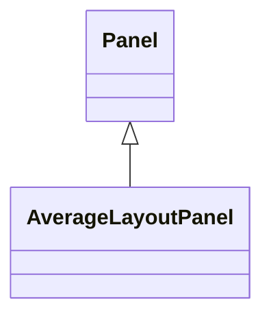

# AverageLayoutPanel

**Namespace:** `mne::viz` &nbsp;·&nbsp; **Library:** Visualization Library &nbsp;·&nbsp; **Source:** [`viz/panels/average_layout_panel.h`](https://github.com/mne-tools/mne-cpp/blob/staging/src/libs/mne/viz/panels/average_layout_panel.h)

`#include <mne/viz/average_layout_panel.h>`

```cpp
class mne::viz::AverageLayoutPanel
```

Tool panel with the averages of the selected channels in tiles at their sensor positions.

The selection gives the channels and their layout positions; the evoked data their averages. Channel rows come from the selection, or by name from the channel lookup. Kinds and units, which pick each tile's scale, come from the measurement info.

```cpp title="src/examples/ex_scene_sdl/main.cpp"
// An N100-like deflection that grows towards the back of the grid, and a later positive wave
auto info = std::make_shared<mne::FiffInfo>();
Eigen::MatrixXd auditory = Eigen::MatrixXd::Zero(kSensors, kSamples);
std::vector<AverageLayoutFigure::Channel> selection;
for (int i = 0; i < kSensors; ++i) {
    const int row = i / 4;
    const int column = i % 4;
    mne::FiffChInfo channel;
    channel.ch_name = "EEG " + std::to_string(i + 1);
    channel.kind = FIFFV_EEG_CH;
    channel.unit = FIFF_UNIT_V;
    info->chs.push_back(channel);
    info->ch_names.push_back(channel.ch_name);
    for (int s = kPreStimulus; s < kSamples; ++s) {
        const double t = (s - kPreStimulus) / kSfreq;
        const double n100 = -std::exp(-std::pow((t - 0.1) / 0.02, 2));
        const double p300 = 0.6 * std::exp(-std::pow((t - 0.3) / 0.05, 2));
        auditory(i, s) = (n100 * (1.0 + row) + p300) * 5e-6;
    }
    AverageLayoutFigure::Channel tile;
    tile.name = channel.ch_name;
    tile.number = i;
    tile.position = {1.6 * column, -1.2 * row};
    selection.push_back(std::move(tile));
}
info->nchan = kSensors;

AverageLayoutPanel panel;
panel.set_info(info);
panel.set_selection(std::move(selection));
panel.set_scale_map({{FIFFV_EEG_CH, 1e-5f}});
panel.set_average_colors({{"auditory", Color{31, 111, 235}}});
EvokedAverages evoked;
evoked.averages = {{"auditory", auditory.data(), kSamples, kSensors}};
evoked.first_sample = -kPreStimulus;
evoked.bad.assign(kSensors, false);
evoked.bad[5] = true;
panel.set_evoked(std::move(evoked));

// Any panel's figure, without a view written for it
FigureView view(*panel.figure());
view.set_text_metrics(&metrics);
return host.run(view);
```

### Inheritance



---

## Public Methods

### AverageLayoutPanel()

Constructs a panel without channels.

---

### ~AverageLayoutPanel()

---

### layout()

**Returns:**

- *[AverageLayoutFigure](/docs/api/viz/average-layout-figure) &* — The figure of the tiles.

---

### set_info(info)

**Parameters:**

- **info** : *std::shared_ptr&lt; const [FiffInfo](/docs/api/fiff/fiff-info) &gt;*
  Kinds and units of the channels by row.

---

### set_channel_lookup(lookup)

**Parameters:**

- **lookup** : *std::function&lt; int(const std::string &)&gt;*
  Row of a channel by its layout name, -1 if unknown; when set, it gives the rows instead of the selection.

---

### set_selection(channels)

Shows the channels of a selection, at their layout positions.

**Parameters:**

- **channels** : *std::vector&lt; [AverageLayoutFigure](/docs/api/viz/average-layout-figure)::Channel &gt;*
  The channels, without averages.

---

### set_evoked(evoked)

Shows the averages of an evoked set; the data must stay valid until the next call or `clear_evoked()`.

**Parameters:**

- **evoked** : *[EvokedAverages](/docs/api/viz/evoked-averages)*
  The averages.

---

### clear_evoked()

Removes the averages, keeping the channels.

---

### set_scale_map(scales)

**Parameters:**

- **scales** : *std::map&lt; int, float &gt;*
  Value at the top edge of a tile, by channel kind, or by unit for MEG.

---

### set_average_colors(colors)

**Parameters:**

- **colors** : *std::map&lt; std::string, [Color](/docs/api/viz/color) &gt;*
  Colour of each average, by comment.

---

### average_colors()

**Returns:**

- *const std::map&lt; std::string, [Color](/docs/api/viz/color) &gt; &* — The colour of each average, by comment.

---

### set_single_average_color(color)

Gives all averages, and those without a colour of their own, the same colour.

**Parameters:**

- **color** : *[Color](/docs/api/viz/color)*
  The colour.

---

### set_average_activation(activation)

**Parameters:**

- **activation** : *std::map&lt; std::string, bool &gt;*
  Whether each average, by comment, is drawn.

---

### average_activation()

**Returns:**

- *const std::map&lt; std::string, bool &gt; &* — Whether each average, by comment, is drawn.

---

## Example

- Start here: [ex_scene_sdl](../../examples/viz/ex_scene_sdl.mdx) — Trace view in an SDL3 window, without Qt: mne_scene's view and software renderer in another toolkit.
- Full source: [`src/examples/ex_scene_sdl/main.cpp`](https://github.com/mne-tools/mne-cpp/tree/staging/src/examples/ex_scene_sdl/main.cpp)
- Build target: `ex_scene_sdl` (runs under CTest)

## Used in examples

### [ex_scene_sdl](../../examples/viz/ex_scene_sdl.mdx)

Trace view in an SDL3 window, without Qt: mne_scene's view and software renderer in another toolkit.

````cpp title="src/examples/ex_scene_sdl/main.cpp, line 142"
AverageLayoutPanel panel;
panel.set_info(info);
panel.set_selection(std::move(selection));
panel.set_scale_map({{FIFFV_EEG_CH, 1e-5f}});
panel.set_average_colors({{"auditory", Color{31, 111, 235}}});
EvokedAverages evoked;
evoked.averages = {{"auditory", auditory.data(), kSamples, kSensors}};
evoked.first_sample = -kPreStimulus;
evoked.bad.assign(kSensors, false);
evoked.bad[5] = true;
panel.set_evoked(std::move(evoked));
````

## Authors of this file

- Christoph Dinh &lt;christoph.dinh@mne-cpp.org&gt;
