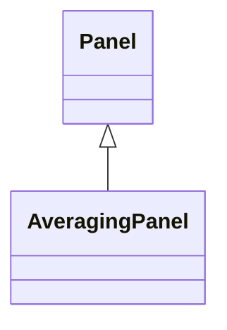

# AveragingPanel

**Namespace:** `mne::viz` &nbsp;·&nbsp; **Library:** Visualization Library &nbsp;·&nbsp; **Source:** [`viz/panels/averaging_panel.h`](https://github.com/mne-tools/mne-cpp/blob/staging/src/libs/mne/viz/panels/averaging_panel.h)

`#include <mne/viz/averaging_panel.h>`

```cpp
class mne::viz::AveragingPanel
```

Tool panel of the averaging: the stimulus channel and number of trials (real time), the epoch window, the baseline correction within it, the detected trials per type, and the offline options to drop rejected epochs, recompute live and save.

The baseline stays inside the epoch window. The settings keep the keys of the former AveragingSettingsView; the stimulus channel is kept by name until the channels arrive.

### Inheritance



---

## Public Methods

### AveragingPanel(stimChannels)

**Parameters:**

- **stimChannels** : *const std::map&lt; std::string, int &gt; &*
  Stimulus channels by name with their indices.

---

### ~AveragingPanel()

---

### set_callbacks(callbacks)

**Parameters:**

- **callbacks** : *Callbacks*
  The reports of the panel.

---

### set_stim_channels(stimChannels)

Offers the stimulus channels; the stored one stays selected when present.

An empty map is ignored.

**Parameters:**

- **stimChannels** : *const std::map&lt; std::string, int &gt; &*
  Stimulus channels by name with their indices.

---

### set_detected_epochs(evokedSet)

Lists the averages of `evokedSet` with their number of trials, at most ten.

**Parameters:**

- **evokedSet** : *const [FiffEvokedSet](/docs/api/fiff/fiff-evoked-set) &*
  The current averages.

---

### current_stim_channel()

**Returns:**

- *const std::string &* — The stimulus channel chosen or stored.

---

### stim_channel_index()

**Returns:**

- *int* — The index of the selected stimulus channel, or 0.

---

### baseline_correction()

**Returns:**

- *bool* — Whether baseline correction is on.

---

### num_averages()

**Returns:**

- *int* — The number of trials per average.

---

### baseline_from()

**Returns:**

- *int* — Start of the baseline in ms.

---

### baseline_to()

**Returns:**

- *int* — End of the baseline in ms.

---

### pre_stim()

**Returns:**

- *int* — Time before the stimulus in ms.

---

### post_stim()

**Returns:**

- *int* — Time after the stimulus in ms.

---

### auto_compute()

**Returns:**

- *bool* — Whether averages are recomputed live.

---

### load(store, path)

Restores the settings without reporting them and fits the baseline into the stored epoch window.

**Parameters:**

- **store** : *const [SettingsStore](/docs/api/viz/settings-store) &*
  Settings store.

- **path** : *const std::string &*
  Settings path.

---

### save(store, path)

**Parameters:**

- **store** : *[SettingsStore](/docs/api/viz/settings-store) &*
  Settings store.

- **path** : *const std::string &*
  Settings path.

---

## Example

No example of its own: Tool panel of an MNE Scan and MNE Analyze plugin, shown by the backends' panel hosts; works like CompensatorPanel, whose example shows the pattern.

## Authors of this file

- Christoph Dinh &lt;christoph.dinh@mne-cpp.org&gt;
