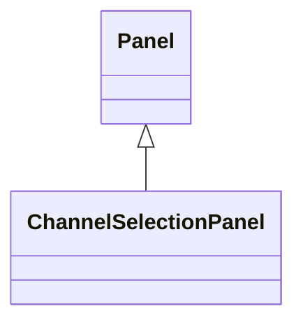

# ChannelSelectionPanel

**Namespace:** `mne::viz` &nbsp;·&nbsp; **Library:** Visualization Library &nbsp;·&nbsp; **Source:** [`viz/panels/channel_selection_panel.h`](https://github.com/mne-tools/mne-cpp/blob/staging/src/libs/mne/viz/panels/channel_selection_panel.h)

`#include <mne/viz/channel_selection_panel.h>`

```cpp
class mne::viz::ChannelSelectionPanel
```

Tool panel to pick the channels the data views show: a sensor layout, named selection groups and the channels picked by hand.

The form chooses the layout file (.lout; EEG channels without one are laid out from their digitiser points), the selection group file (.sel or .mon) and whether bad channels are drawn red, and saves the groups. The groups list holds the groups of the file plus "All" (the channels mapped to the layout) and "All EEG"; choosing one shows its channels and lets only them be picked in the layout. Clicks and rubber bands in the layout pick channels, which a named group can keep. Delete removes picked channels and groups, but not "All" and "All EEG".

The channels of the measurement come from a [`ChannelTable`](/docs/api/viz/channel-table). The panel reports the channels to show (by their names in the measurement), the picked sensors and every loaded layout through its callbacks.

```cpp title="src/examples/ex_scene_sdl/main.cpp"
// The Vectorview layout and the mne_browse_raw groups of the installed resources
ChannelSelectionPanel panel;
ChannelSelectionPanel::Callbacks callbacks;
callbacks.channels_shown = [](const std::vector<std::string>& channels) {
    std::printf("Showing %zu channels\n", channels.size());
};
panel.set_callbacks(std::move(callbacks));
panel.set_mapped_channels({"MEG 0111", "MEG 0112", "MEG 0113", "MEG 0121"});
panel.select_channels({"MEG 0112"});

// Any panel's lists, without a view written for them
FormView view(panel);
view.set_text_metrics(&metrics);
return host.run(view);
```

### Inheritance



---

## Public Methods

### ChannelSelectionPanel(resources)

Constructs the panel with the Vectorview layout and the mne_browse_raw groups.

**Parameters:**

- **resources** : *std::filesystem::path*
  Directory with the 2DLayouts and selectionGroups folders; empty for the installed resources/general.

---

### ~ChannelSelectionPanel()

---

### set_callbacks(callbacks)

**Parameters:**

- **callbacks** : *Callbacks*
  What to call on changes.

---

### sensors()

**Returns:**

- *[SensorLayoutFigure](/docs/api/viz/sensor-layout-figure) &* — The sensors of the layout.

---

### set_channel_table(table)

**Parameters:**

- **table** : *std::shared_ptr&lt; const [ChannelTable](/docs/api/viz/channel-table) &gt;*
  The channels of the measurement: names, layout names, kinds, digitiser points and bad channels; null for none.

---

### set_mapped_channels(names)

Sets the channels of group "All", the measurement's channels that the layout knows, and selects the group.

**Parameters:**

- **names** : *const std::vector&lt; std::string &gt; &*
  Layout names of the channels.

---

### load_layout(file)

Reads a layout; EEG channels it does not have are laid out from their digitiser points.

**Parameters:**

- **file** : *const std::string &*
  A file of the 2DLayouts folder or an absolute path.

**Returns:**

- *bool* — Whether the file was read.

---

### reload_layout()

Reads the layout again, e.g.

for a new measurement whose EEG channels have other digitiser points.

---

### load_selection_groups(file)

Reads selection groups; "All" and "All EEG" are added.

**Parameters:**

- **file** : *const std::string &*
  A file of the selectionGroups folder or an absolute path, .sel or .mon.

**Returns:**

- *bool* — Whether the file was read.

---

### save_selection_groups(path)

Writes the groups but "All" and "All EEG".

**Parameters:**

- **path** : *const std::filesystem::path &*
  A .sel file, or a .mon file whose folder gets one file per group.

**Returns:**

- *bool* — Whether the groups were written.

---

### layout_file()

**Returns:**

- *std::string* — The layout file shown.

---

### group_file()

**Returns:**

- *std::string* — The selection group file loaded.

---

### layout_map()

**Returns:**

- *const std::map&lt; std::string, [Point](/docs/api/viz/point) &gt; &* — Layout position of each channel by layout name.

---

### selection_groups()

**Returns:**

- *const std::map&lt; std::string, std::vector&lt; std::string &gt; &gt; &* — The selection groups by name.

---

### highlight_channels(names)

**Parameters:**

- **names** : *const std::vector&lt; std::string &gt; &*
  Layout names of the channels to ring in the layout.

---

### select_channels(names)

Picks channels as clicks in the layout do.

**Parameters:**

- **names** : *const std::vector&lt; std::string &gt; &*
  Layout names of the channels.

---

### selected_channels()

**Returns:**

- *std::vector&lt; std::string &gt;* — Layout names of the picked channels, or without any those of the current group.

---

### selection_empty()

**Returns:**

- *bool* — Whether group "All" is chosen and no channel is picked.

---

### update_bad_channels()

Draws the bad channels of the table red, if the form says so, and reports the channels to show.

---

### update_data_view()

Reports the channels to show and the picked sensors.

---

### clear()

Removes the sensors.

---

### groups()

**Returns:**

- *[ItemList](/docs/api/viz/item-list) &* — The selection groups.

---

### group_channels()

**Returns:**

- *[ItemList](/docs/api/viz/item-list) &* — The channels of the current group.

---

### picked_channels()

**Returns:**

- *[ItemList](/docs/api/viz/item-list) &* — The channels picked by hand.

---

## Example

- Start here: [ex_scene_sdl](../../examples/viz/ex_scene_sdl.mdx) — Trace view in an SDL3 window, without Qt: mne_scene's view and software renderer in another toolkit.
- Full source: [`src/examples/ex_scene_sdl/main.cpp`](https://github.com/mne-tools/mne-cpp/tree/staging/src/examples/ex_scene_sdl/main.cpp)
- Build target: `ex_scene_sdl` (runs under CTest)

## Used in examples

### [ex_scene_sdl](../../examples/viz/ex_scene_sdl.mdx)

Trace view in an SDL3 window, without Qt: mne_scene's view and software renderer in another toolkit.

````cpp title="src/examples/ex_scene_sdl/main.cpp, line 221"
// The Vectorview layout and the mne_browse_raw groups of the installed resources
ChannelSelectionPanel panel;
ChannelSelectionPanel::Callbacks callbacks;
callbacks.channels_shown = [](const std::vector<std::string>& channels) {
    std::printf("Showing %zu channels\n", channels.size());
};
panel.set_callbacks(std::move(callbacks));
panel.set_mapped_channels({"MEG 0111", "MEG 0112", "MEG 0113", "MEG 0121"});
panel.select_channels({"MEG 0112"});
````

## Authors of this file

- Christoph Dinh &lt;christoph.dinh@mne-cpp.org&gt;
