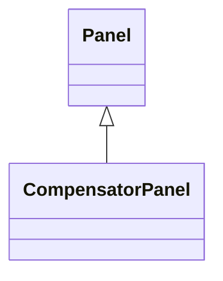

# CompensatorPanel

**Namespace:** `mne::viz` &nbsp;·&nbsp; **Library:** Visualization Library &nbsp;·&nbsp; **Source:** [`viz/panels/compensator_panel.h`](https://github.com/mne-tools/mne-cpp/blob/staging/src/libs/mne/viz/panels/compensator_panel.h)

`#include <mne/viz/compensator_panel.h>`

```cpp
class mne::viz::CompensatorPanel
```

One check box per compensation grade of the data; at most one is on.

The state of each grade is remembered across sessions under "&lt;path&gt;/CompensatorView/active".

```cpp title="src/examples/ex_scene/main.cpp"
// A tool panel holds its state and rules once; every backend shows it with one generic host
// (viz::qt::PanelWidget for Qt) and stores it through a SettingsStore
std::vector<mne::FiffCtfComp> comps(2);
comps[0].kind = 1;
comps[1].kind = 3;
CompensatorPanel compensators;
int grade = -1;
compensators.set_selection_callback([&grade](int to) {
    grade = to;
});
compensators.set_compensators(comps);
compensators.form().set_value(CompensatorPanel::field_key(3), true);
MemorySettingsStore settings;
compensators.save(settings, "ex_scene");
```

### Inheritance



---

## Public Methods

### CompensatorPanel()

---

### ~CompensatorPanel()

---

### set_compensators(comps)

Shows the compensators of the data; a remembered grade is chosen again and reported.

**Parameters:**

- **comps** : *const std::vector&lt; [FiffCtfComp](/docs/api/fiff/fiff-ctf-comp) &gt; &*
  Compensators of the measurement info.

---

### compensators()

**Returns:**

- *const std::vector&lt; [FiffCtfComp](/docs/api/fiff/fiff-ctf-comp) &gt; &* — The compensators shown.

---

### selected()

**Returns:**

- *int* — The chosen grade, 0 for none.

---

### select(to)

Chooses a grade, as a click on its check box does.

**Parameters:**

- **to** : *int*
  FIFF kind of a shown compensator, 0 for none.

---

### set_selection_callback(callback)

**Parameters:**

- **callback** : *SelectionCallback*
  Called whenever the chosen grade changes.

---

### load(store, path)

Restores the panel from `store`.

By default the persistent form fields are read from "&lt;path&gt;/&lt;id&gt;/&lt;field key&gt;".

**Parameters:**

- **store** : *const [SettingsStore](/docs/api/viz/settings-store) &*
  Stored settings.

- **path** : *const std::string &*
  Settings path of the host, e.g. "MNESCAN/NoiseReduction"; empty restores nothing.

---

### save(store, path)

Stores the panel in `store`, under the keys `load()` reads.

**Parameters:**

- **store** : *[SettingsStore](/docs/api/viz/settings-store) &*
  Stored settings.

- **path** : *const std::string &*
  Settings path of the host; empty stores nothing.

---

## Static Methods

### field_key(kind)

**Parameters:**

- **kind** : *int*
  FIFF kind of a compensator.

**Returns:**

- *std::string* — The form key of the check box of the grade.

---

## Example

- Start here: [ex_scene](../../examples/viz/ex_scene.mdx) — Scene library: draw a figure on a Canvas, plot a line chart, and write both as SVG and PNG without Qt.
- Full source: [`src/examples/ex_scene/main.cpp`](https://github.com/mne-tools/mne-cpp/tree/staging/src/examples/ex_scene/main.cpp)
- Build target: `ex_scene` (runs under CTest)

## Used in examples

### [ex_scene](../../examples/viz/ex_scene.mdx)

Scene library: draw a figure on a Canvas, plot a line chart, and write both as SVG and PNG without Qt.

````cpp title="src/examples/ex_scene/main.cpp, line 187"
std::vector<mne::FiffCtfComp> comps(2);
comps[0].kind = 1;
comps[1].kind = 3;
CompensatorPanel compensators;
int grade = -1;
compensators.set_selection_callback([&grade](int to) {
    grade = to;
});
compensators.set_compensators(comps);
compensators.form().set_value(CompensatorPanel::field_key(3), true);
MemorySettingsStore settings;
compensators.save(settings, "ex_scene");
ok &= expect(grade == 3 && compensators.selected() == 3, "a click on a compensator's check box chooses its grade");
````

### [ex_scene_sdl](../../examples/viz/ex_scene_sdl.mdx)

Trace view in an SDL3 window, without Qt: mne_scene's view and software renderer in another toolkit.

````cpp title="src/examples/ex_scene_sdl/main.cpp, line 225"
    auto compensator = std::make_unique<CompensatorPanel>();
    std::vector<mne::FiffCtfComp> comps(3);
    for (int i = 0; i < 3; ++i) {
        comps[static_cast<std::size_t>(i)].kind = i + 1;
    }
    compensator->set_compensators(comps);
    compensator->set_selection_callback([](int to) {
        std::printf("Compensation grade %d\n", to);
    });
    panel = std::move(compensator);
} else {
    auto projectors = std::make_unique<ProjectorsPanel>();
    std::vector<mne::FiffProj> projs(4);
    const char* descriptions[] = {"Average EEG reference", "PCA-v1 (planar)", "PCA-v2 (axial)", "ECG-planar-999--0.200-0.400-PCA-01"};
````

## Authors of this file

- Christoph Dinh &lt;christoph.dinh@mne-cpp.org&gt;
