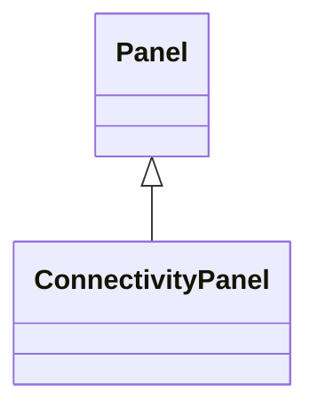

# ConnectivityPanel

**Namespace:** `mne::viz` &nbsp;·&nbsp; **Library:** Visualization Library &nbsp;·&nbsp; **Source:** [`viz/panels/connectivity_panel.h`](https://github.com/mne-tools/mne-cpp/blob/staging/src/libs/mne/viz/panels/connectivity_panel.h)

`#include <mne/viz/connectivity_panel.h>`

```cpp
class mne::viz::ConnectivityPanel
```

Tool panel of the functional connectivity: the metric (COR, COH, IMAGCOH, XCOR, PLI, DSWPLI, USPLI, WPLI, PLV), the window type, the number of trials, the trigger type and the frequency band.

The settings are stored under "&lt;path&gt;/ConnectivitySettingsView/&lt;key&gt;" and restored without reports, so hosts read them once after the restore.

### Inheritance



---

## Public Methods

### ConnectivityPanel()

Constructs the panel: COR, Hanning window, 10 trials, 7 to 13 Hz.

---

### ~ConnectivityPanel()

---

### set_callbacks(callbacks)

**Parameters:**

- **callbacks** : *Callbacks*
  What to call on changes.

---

### set_trigger_types(types)

Adds trigger types the panel does not offer yet.

**Parameters:**

- **types** : *const std::vector&lt; std::string &gt; &*
  Trigger types.

---

### set_number_trials(trials)

**Parameters:**

- **trials** : *int*
  Number of trials, without a report.

---

### set_frequency_band(low, high)

**Parameters:**

- **low** : *double*
  Lower edge in Hz.

- **high** : *double*
  Upper edge in Hz.

---

### metric()

**Returns:**

- *std::string* — The metric.

---

### window_type()

**Returns:**

- *std::string* — The window type.

---

### number_trials()

**Returns:**

- *int* — The number of trials.

---

### trigger_type()

**Returns:**

- *std::string* — The trigger type.

---

### lower_frequency()

**Returns:**

- *double* — The lower edge of the band in Hz.

---

### upper_frequency()

**Returns:**

- *double* — The upper edge of the band in Hz.

---

### load(store, path)

Restores the settings without reporting them.

**Parameters:**

- **store** : *const [SettingsStore](/docs/api/viz/settings-store) &*
  Stored settings.

- **path** : *const std::string &*
  Settings path of the host.

---

## Example

No example of its own: Tool panel of the MNE Scan connectivity plugin and the connectivity examples, which host it; works like CompensatorPanel, whose example shows the pattern.

## Used in examples

### [ex_connectivity](../../examples/connectivity/ex_connectivity.mdx)

Sensor- or source-level functional connectivity of averaged MEG/EEG data with a selectable metric, shown as a 3D network.

````cpp title="src/examples/ex_connectivity/main.cpp, line 368"
// The connectivity settings as a standalone panel
auto pConnPanel = std::make_shared<ConnectivityPanel>();
ConnectivityPanel::Callbacks connCallbacks;
connCallbacks.metric_changed = [&pConnectivitySettingsManager](const std::string& metric) {
    pConnectivitySettingsManager->onConnectivityMetricChanged(QString::fromStdString(metric));
};
connCallbacks.number_trials_changed = [&pConnectivitySettingsManager, &pConnPanel, iNumTrials](int trials) {
    pConnPanel->set_number_trials(qMin(iNumTrials, trials));
    pConnectivitySettingsManager->onNumberTrialsChanged(qMin(iNumTrials, trials));
};
connCallbacks.frequency_band_changed = [&pConnectivitySettingsManager](float low, float high) {
    pConnectivitySettingsManager->onFreqBandChanged(low, high);
};
pConnPanel->set_callbacks(std::move(connCallbacks));
````

### [ex_connectivity_comparison](../../examples/connectivity/ex_connectivity_comparison.mdx)

Compare connectivity metrics side by side on the same averaged sensor- or source-level data.

````cpp title="src/examples/ex_connectivity_comparison/main.cpp, line 369"
// Create ConnectivitySettingsView as standalone widget
auto pConnPanel = std::make_shared<ConnectivityPanel>();
auto pConnSettingsView = std::make_unique<PanelWidget>(pConnPanel, QStringLiteral("EX_CONNECTIVITY_COMP"));
pConnPanel->set_number_trials(iNumTrials);
pConnPanel->set_frequency_band(dFreqMin, dFreqMax);
````

## Authors of this file

- Christoph Dinh &lt;christoph.dinh@mne-cpp.org&gt;
