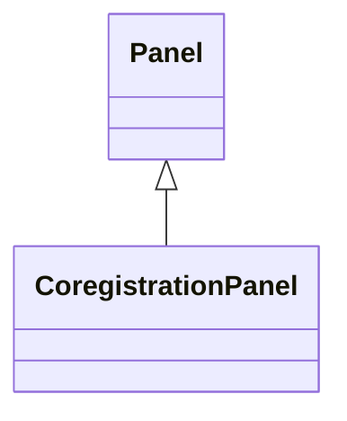

# CoregistrationPanel

**Namespace:** `mne::viz` &nbsp;·&nbsp; **Library:** Visualization Library &nbsp;·&nbsp; **Source:** [`viz/panels/coregistration_panel.h`](https://github.com/mne-tools/mne-cpp/blob/staging/src/libs/mne/viz/panels/coregistration_panel.h)

`#include <mne/viz/coregistration_panel.h>`

```cpp
class mne::viz::CoregistrationPanel
```

Tool panel of the MRI-head co-registration: the head surface (BEM), the MRI fiducials picked in a 3D view or loaded from a file, the digitizers, the weights and options of the fiducial and ICP fits, and the scaling, rotation and translation of the transformation.

Files to load or store are chosen in path fields; a store path is cleared after it was reported, so the same file can be stored again. Programmatic changes are not reported; the user's are. Nothing is stored.

### Inheritance



---

## Public Methods

### CoregistrationPanel()

Creates the panel without BEMs, picking the LPA first.

---

### ~CoregistrationPanel()

---

### set_callbacks(callbacks)

**Parameters:**

- **callbacks** : *Callbacks*
  What the panel reports.

---

### set_bems(names)

Sets the BEMs to choose from; the chosen one stays if it is still there, else the first one is chosen.

**Parameters:**

- **names** : *const std::vector&lt; std::string &gt; &*
  Names of the BEMs; none shows "Select BEM".

---

### bem()

**Returns:**

- *std::string* — The chosen BEM; empty for none.

---

### set_fiducial(position)

Stores the position of the fiducial being picked and steps to the next one (LPA, nasion, RPA, LPA, ...).

**Parameters:**

- **position** : *const Eigen::Vector3f &*
  Position in m.

---

### fiducial()

**Returns:**

- *int* — The fiducial being picked: FIFFV_POINT_LPA, FIFFV_POINT_NASION or FIFFV_POINT_RPA.

---

### picking()

**Returns:**

- *bool* — Whether fiducials are picked in the 3D view.

---

### set_omitted_points(points)

Shows the number of digitizers left out of the ICP fit.

**Parameters:**

- **points** : *int*
  Number of points.

---

### set_rmse(rmse)

Shows the root mean square distance between the digitizers and the head surface after the ICP fit.

**Parameters:**

- **rmse** : *float*
  Distance in m.

---

### max_iterations()

**Returns:**

- *int* — The maximum number of ICP iterations.

---

### convergence()

**Returns:**

- *float* — The convergence limit of ICP in m.

---

### auto_scale()

**Returns:**

- *bool* — Whether the fiducial fit scales uniformly.

---

### omit_distance()

**Returns:**

- *float* — The maximum distance in m of digitizers from the head surface; farther ones are left out.

---

### weight_lpa()

**Returns:**

- *float* — The weight of the LPA.

---

### weight_rpa()

**Returns:**

- *float* — The weight of the RPA.

---

### weight_nasion()

**Returns:**

- *float* — The weight of the nasion.

---

### weight_eeg()

**Returns:**

- *float* — The weight of the EEG points.

---

### weight_hsp()

**Returns:**

- *float* — The weight of the head shape points.

---

### weight_hpi()

**Returns:**

- *float* — The weight of the HPI points.

---

### digitizer_kinds()

**Returns:**

- *std::vector&lt; int &gt;* — The kinds of digitizers (FIFFV_POINT_CARDINAL and the chosen EEG, HPI, EXTRA) used for ICP.

---

### transformation(rotation, translation, scaling)

The transformation set in the panel.

**Parameters:**

- **rotation** : *Eigen::Vector3f &*
  Rotation angles in rad around z, y and x (Euler order).

- **translation** : *Eigen::Vector3f &*
  Translation in m.

- **scaling** : *Eigen::Vector3f &*
  Scaling along x, y and z, from the scaling mode.

---

### set_transformation(translation, rotation, scaling)

Shows a transformation, e.g.

a fitted one.

**Parameters:**

- **translation** : *const Eigen::Vector3f &*
  Translation in m.

- **rotation** : *const Eigen::Vector3f &*
  Rotation angles in rad around z, y and x (Euler order).

- **scaling** : *const Eigen::Vector3f &*
  Scaling along x, y and z.

---

## Example

No example of its own: Tool panel of an MNE Scan or MNE Analyze plugin, shown by the backends' panel hosts; works like CompensatorPanel, whose example shows the pattern.

## Authors of this file

- Christoph Dinh &lt;christoph.dinh@mne-cpp.org&gt;
