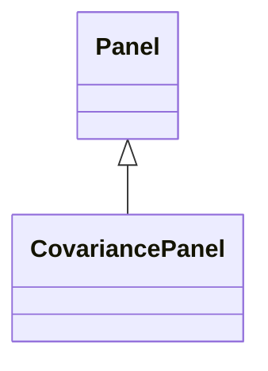

# CovariancePanel

**Namespace:** `mne::viz` &nbsp;·&nbsp; **Library:** Visualization Library &nbsp;·&nbsp; **Source:** [`viz/panels/covariance_panel.h`](https://github.com/mne-tools/mne-cpp/blob/staging/src/libs/mne/viz/panels/covariance_panel.h)

`#include <mne/viz/covariance_panel.h>`

```cpp
class mne::viz::CovariancePanel
```

Tool panel of the covariance estimation: the number of samples, from one second to a minute of data in steps of 600 samples.

The number comes from the plugin and is not stored.

### Inheritance



---

## Public Methods

### CovariancePanel()

Constructs the panel with 600 samples.

---

### ~CovariancePanel()

---

### set_samples_callback(callback)

**Parameters:**

- **callback** : *std::function&lt; void(int samples)&gt;*
  Called with the number of samples the user chose.

---

### set_minimum_samples(samples)

Sets the range of samples without a report; the current number is clamped into it.

**Parameters:**

- **samples** : *int*
  Samples of one second; a minute is the most.

---

### set_samples(samples)

**Parameters:**

- **samples** : *int*
  Number of samples, without calling back.

---

### samples()

**Returns:**

- *int* — The number of samples.

---

## Example

No example of its own: Tool panel of an MNE Scan plugin, shown by the backends' panel hosts; works like CompensatorPanel, whose example shows the pattern.

## Authors of this file

- Christoph Dinh &lt;christoph.dinh@mne-cpp.org&gt;
