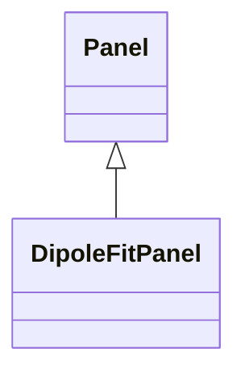

# DipoleFitPanel

**Namespace:** `mne::viz` &nbsp;·&nbsp; **Library:** Visualization Library &nbsp;·&nbsp; **Source:** [`viz/panels/dipole_fit_panel.h`](https://github.com/mne-tools/mne-cpp/blob/staging/src/libs/mne/viz/panels/dipole_fit_panel.h)

`#include <mne/viz/dipole_fit_panel.h>`

```cpp
class mne::viz::DipoleFitPanel
```

Tool panel of the dipole fit: the measurement and data set, the modalities, the time scale, the baseline, the fitting guesses, the noise (manual, regularization or a noise covariance file), the forward model (BEM, MRI coordinates or a sphere model) and the name of the fit.

Models are chosen by name; "None" chooses none. Choosing a measurement names the fit after it. Programmatic changes are not reported; the user's are. Nothing is stored.

### Inheritance



---

## Public Methods

### DipoleFitPanel()

Creates the panel with MNE-C's defaults, e.g.

a sphere model at (0, 0, 40) mm with a radius of 90 mm.

---

### ~DipoleFitPanel()

---

### set_callbacks(callbacks)

**Parameters:**

- **callbacks** : *Callbacks*
  What the panel reports.

---

### add_model(kind, name)

Adds a model to choose from.

**Parameters:**

- **kind** : *Model*
  Kind of the model.

- **name** : *const std::string &*
  File name of the model.

---

### remove_model(kind, name)

Removes a model; if it was chosen, "None" is chosen.

**Parameters:**

- **kind** : *Model*
  Kind of the model.

- **name** : *const std::string &*
  File name of the model.

---

### model(kind)

**Parameters:**

- **kind** : *Model*
  Kind of the models.

**Returns:**

- *std::string* — The chosen model, "None" for none.

---

### report_parameters()

Reports all parameters except the models, e.g.

so a new host starts from them.

---

### fit_name()

**Returns:**

- *std::string* — The name of the fit.

---

## Static Methods

### measurement_name(measurement)

**Parameters:**

- **measurement** : *const std::string &*
  File name of a measurement, e.g. "sample_audvis-ave.fif".

**Returns:**

- *std::string* — The base name of the measurement without extension and "-ave", "_ave", "-raw" or "_raw" suffix; empty for a name without any.

---

## Example

No example of its own: Tool panel of an MNE Scan or MNE Analyze plugin, shown by the backends' panel hosts; works like CompensatorPanel, whose example shows the pattern.

## Authors of this file

- Christoph Dinh &lt;christoph.dinh@mne-cpp.org&gt;
